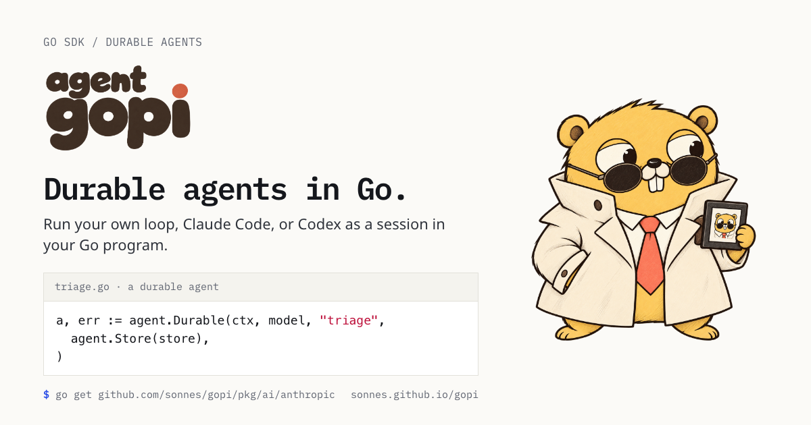

# gopi

[](https://pkg.go.dev/github.com/sonnes/gopi)
[](LICENSE)



gopi is a Go SDK for durable agents. Run your own agent loop, Claude Code, or Codex as a session in your Go program. If the process stops, the next run continues from the last stored message.

[Site](https://sonnes.github.io/gopi/) · [Documentation](https://sonnes.github.io/gopi/docs/) · [GoDoc](https://pkg.go.dev/github.com/sonnes/gopi)

## Install

gopi needs Go 1.27 or later. Each provider is its own module, and it requires the root module, so one `go get` adds both:

```sh
go get github.com/sonnes/gopi/pkg/ai/anthropic
```

## Quick Start

Make one model call:

```go
model := ai.LanguageModel{
	Model:    ai.Model{ID: "claude-sonnet-5"},
	Provider: anthropic.New(), // reads ANTHROPIC_API_KEY
}

msg, err := model.StreamText(ctx, []ai.Message{
	ai.UserMessage("Say hello in one sentence."),
}).Wait()
if err != nil {
	log.Fatal(err)
}
fmt.Println(msg.Text())
```

Give a Go function to an agent as a tool. `tool.New` derives the JSON schema from the input type:

```go
type WeatherIn struct {
	City string `json:"city" jsonschema:"the name of the city"`
}

weather := tool.New("get_weather",
	func(ctx context.Context, in WeatherIn) (string, error) {
		return forecast(in.City), nil
	},
	tool.Description("Get the weather for a city"),
)

a := agent.New(model, agent.Toolset(weather))
msgs, err := a.Run(ctx, session.Text("Is it warmer in Lisbon or in Oslo?")).Wait()
```

Keep the agent in a session. The session ID is the memory boundary, such as a ticket number or a user ID. The same ID resumes the same conversation in a new process:

```go
store, err := storefs.Sessions("sessions")
if err != nil {
	log.Fatal(err)
}

a, err := agent.Durable(ctx, model, "ticket-4812",
	agent.Store(store),
	agent.Toolset(listIssues, readIssue),
)
if err != nil {
	log.Fatal(err)
}

// With no input, the run continues from the last stored message.
_, err = a.Run(ctx).Wait()
```

The site has [a guide for each job](https://sonnes.github.io/gopi/docs/guides/call-a-model/). The programs of the guides are in [`examples/`](examples/), and `make test` builds each one.

## Pick Your Layer

The SDK is a stack. Each layer calls only the layers under it, so you can use any layer without the layers above it.

| Layer | Package | Use it for |
|---|---|---|
| Host | `pkg/host` | The lifecycle of many sessions over their workspaces: status, approvals, and recovery after a restart |
| Harness | `pkg/harness` | A coding agent from a repository: AGENTS.md, skills, subagents, coding tools, MCP servers, a sandbox, and permission rules |
| Agent | `pkg/agent` | The loop of model calls and tool calls, with hooks, steer, follow-up, and typed events |
| Session | `pkg/session`, `pkg/store/fs` | The log of a session in a store, which survives a crash |
| Tool | `pkg/tool`, `pkg/mcp` | Typed Go functions and MCP servers as tools |
| Model call | `pkg/ai` | One call: messages and options in, a stream of events and a message out |
| Catalog | `pkg/catalog` | Model specs, such as `anthropic/claude-opus-5-5`, resolved to a provider or a driver |

Under each layer is `pkg/stream`: one producer, one consumer, and one result.

## Durable Sessions

A durable agent stores each message before it sends the event of the message. So each event that a reader saw complete survives a crash, and a crash loses at most the message in flight. A tool call that a crash cut short gets an error result, and the next run continues from there.

The log only appends. A custom entry keeps application state in its place among the messages, and the model never reads it. A session value keeps state next to the log, such as the model spec of the session.

`storefs.Sessions` keeps sessions in files, and `session.NewMemoryStore` keeps them in memory. To keep sessions in your own database, implement `session.Storer`.

## Managed Agents

A host runs the lifecycle of each session. It starts the agent, runs one message at a time, waits for a person when a tool call needs an approval, and recovers each session after a restart. Each session pairs an agent with a workspace: the folder that it works in, and the folders of its AGENTS.md, skills, and subagents.

```go
h, err := host.Open(ctx, cat, host.Store(store))
if err != nil {
	log.Fatal(err)
}

s, err := h.Create(ctx, host.Config{
	Model: "claude-code/claude-opus-5-5",
	Dir:   "repos/app",
	Deny:  []string{"Bash(git push:*)"},
})
if err != nil {
	log.Fatal(err)
}

err = h.Send(ctx, s.ID, host.Text("Fix the failing test."))
```

The model spec picks the agent of a session. `claude-code/...` and `codex/...` start their CLI. A provider, such as `anthropic/...`, runs on the harness. The harness, Claude Code, and Codex send the same events and keep the same log.

## Providers and Drivers

A provider serves a model call. A driver starts an agent. A model spec names one of them and a model.

| Prefix | Kind | Auth | Package |
|---|---|---|---|
| `anthropic` | provider | API key | `pkg/ai/anthropic` |
| `openai` | provider | API key | `pkg/ai/openai` |
| `openaichat` | provider | API key | `pkg/ai/openaichat` |
| `chatgpt` | provider | ChatGPT sign-in | `pkg/ai/chatgpt` |
| `fireworks` | provider | API key | `pkg/ai/fireworks` |
| `openrouter` | provider | API key | `pkg/ai/openrouter` |
| `claude-code` | driver | CLI login | `pkg/agent/claude` |
| `codex` | driver | CLI login | `pkg/agent/codex` |

A spec with no driver runs on the harness, the default driver. `models.json` holds the default models of each provider and driver, and `catalog.ReadModelFile` reads it.

## Try the CLI

`cmd/gopi` is a test drive of the SDK. It builds a coding agent with the harness, in a sandbox in the current folder.

```sh
make build
.bin/gopi --model anthropic/claude-opus-5-5 "Summarize README.md"
```

With no prompt, gopi reads stdin, and each line is one run of the same conversation. `--session-id` keeps the conversation in a session. `gopi login chatgpt` signs in with a ChatGPT account, so the `chatgpt` provider runs on the ChatGPT plan with no API key. `gopi models` lists the specs that `--model` takes.

## Concepts

Each abstraction has a concept page in [`docs/concepts/`](docs/concepts/README.md), with its design rules and a map to its code. The site shows the same pages under Concepts.

- [Durability](docs/concepts/agent/durability.md): what a crash loses, and how an agent resumes a session.
- [Loop](docs/concepts/agent/loop.md): how an agent runs, and where a hook changes a run.
- [Run Stream](docs/concepts/agent/run-stream.md): the events of one run, in order.
- [Host](docs/concepts/host/host.md): the sessions of a program, with their status and approvals.
- [Harness](docs/concepts/harness/harness.md): how a harness assembles a coding agent.
- [Driver](docs/concepts/agent/driver.md): one interface for the harness, Claude Code, and Codex.
- [Catalog](docs/concepts/catalog/catalog.md): how a model spec resolves.
- [Tool](docs/concepts/tool/tool.md) and [MCP](docs/concepts/tool/mcp.md): typed tools, and the tools of an MCP server.

## Project Structure

```
pkg/
├── ai/          the model call: messages, options, streams, tools
│   └── anthropic, openai, openaichat, chatgpt, fireworks, openrouter
├── tool/        typed Go functions as tools
├── mcp/         the tools of MCP servers
├── session/     the log, its values, and the store contract
├── store/fs/    sessions, agents, and skills in files
├── agent/       the loop, hooks, events, and drivers
│   ├── claude/  Claude Code as an agent
│   └── codex/   Codex as an agent
├── def/         definitions of agents, skills, and instructions
├── harness/     a coding agent from options and definitions
├── host/        the sessions of a program
├── catalog/     model specs, providers, and drivers
├── sandbox/     a local sandbox and its fence
└── stream/      one producer, one consumer, one result
cmd/gopi/        the CLI
examples/        the programs of the site and its guides
web/             the site, with Astro and Starlight
docs/            the concept pages
```

The repository is a Go workspace. Each provider and each command is its own module, and `go.work` joins them.

## Development

Use the `make` targets:

| Target | Purpose |
|---|---|
| `make test` | Run the tests of each module |
| `make check` | Tidy each module, vet the code, and check the format |
| `make build` | Build the CLI to `.bin/` |
| `make site-dev` | Serve the site with hot reload, after `make site-install` |
| `make site-build` | Build the site to `web/dist` |
| `make docs-links` | Make sure that each link in `docs/` and the site resolves |

A push to `main` that changes `web/` or `examples/` deploys the site to GitHub Pages.

## Origins

gopi is a rewrite of pi-go, which started as a Go port of [Mario Zechner](https://github.com/badlogic)'s [pi](https://github.com/badlogic/pi-mono). The vocabulary of messages, content blocks, streaming events, tool calls, and the agent loop comes from pi. The rewrite shapes the rest around Go: typed tools from Go types, one stream for each run with `Events` and `Wait`, a session log that stores each message before its event, and one driver interface for the harness, Claude Code, and Codex.

## License

[Apache License 2.0](LICENSE)
