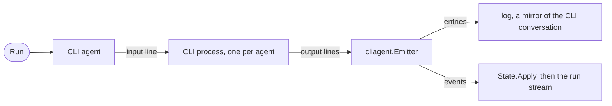

# CLI Agent

A CLI agent runs an agent CLI as a gopi agent. The CLI calls the model and runs the tools in its own loop. The CLI agent turns its output into the events of a run stream, the entries of a log, and a [State](state.md).

## Design

- A CLI agent is an agent, because the CLI runs tools and does not answer one model call. It has the same `Run`, `Log`, `State`, and run stream as `agent.Agent`, so a consumer needs no second path.
- Each CLI has its own package and its own type, and a [driver](driver.md) starts each agent. `New` and `Durable` take the config of the session, as the driver does, so a setting has one name in both packages. An option sets only how the agent starts its CLI, such as the path of the binary.
- The part that does not depend on the CLI is one core in `internal/cliagent`: the session, the start of a run, the wait after an interrupt, and the open and the end of a subagent. So a rule of a run changes in one place for both CLIs.
- The CLI owns the conversation. The [emitter](cli-emitter.md) writes a mirror of it to the log, for display and replay, and the model never reads the log.
- The ID of the CLI conversation is a session value, so `Durable` resumes the same conversation. Each agent reads and writes it only through `internal/resume`, and a caller never sees it.
- A saved Claude Code agent starts a new CLI session with `--session-id`, and the ID is a UUIDv5 of the gopi session ID. So one gopi session always gives the same CLI session. If an earlier CLI made that session and exited before the agent stored the ID, the CLI reports that the ID is in use. Then the agent stores the ID and resumes the session.
- If the CLI cannot find the stored conversation, the run fails with `agent.ErrNoConversation`, and the agent clears the ID. The next run starts a new conversation of the CLI, and the log keeps its messages.
- The CLI runs only its own tools, so the `Tools` of the config pick the tools of the CLI that run, and a CLI agent runs no tool of the caller.
- One process lives as long as the agent: the first run starts it, and `Close` stops it. Each run after the first then starts with no handshake.
- On Unix, the CLI leads a process group of its own, and a stop or a kill signals the whole group. A command that a tool started, such as a sleep in the background, then ends with the CLI. A signal to the CLI only lost, because its children stayed alive after it. The group is a new session, so a command that opens the terminal gets an error and does not stop.
- The packages speak the protocols of the IDE extensions, `codex app-server` and the stream-json mode of `claude`. These protocols interrupt a turn and carry the [requests of the CLI](cli-request.md).
- A cancel interrupts the turn and waits for the end of the turn, so the next run starts from a known state. The agent kills the process only after a timeout.
- A CLI that is not logged in fails the run with `agent.ErrNotLoggedIn`, so a caller can ask the user to log in. The errors are in `pkg/agent`, so one `errors.Is` check works for each driver.
- The tests replay the stdio of the CLI from a trace with `internal/stdiorr`, and `make record-cli` records a trace from the real CLI.

## Map

| Task                                        | File                              |
| ------------------------------------------- | --------------------------------- |
| Change how a CLI agent opens its session or starts a run | `pkg/agent/internal/cliagent/cliagent.go` |
| Change how a subagent of a CLI opens or ends | `pkg/agent/internal/cliagent/child.go` |
| Change how a CLI process starts or stops    | `pkg/agent/internal/cliproc/cliproc.go` |
| Change the environment of a CLI             | `pkg/agent/internal/cliproc/cliproc.go` |
| Change where a CLI keeps its conversation ID | `pkg/agent/internal/resume/resume.go` |
| Change how stderr reaches an error          | `pkg/agent/internal/tail/tail.go` |
| Record or replay a trace                    | `internal/stdiorr/rr.go`          |

## Related Concepts

- [Loop](loop.md)
- [Durability](durability.md)
- [CLI Emitter](cli-emitter.md)
- [CLI Steer](cli-steer.md)
- [CLI Request](cli-request.md)
- [Log](../session/log.md)
- [Value](../session/value.md)
