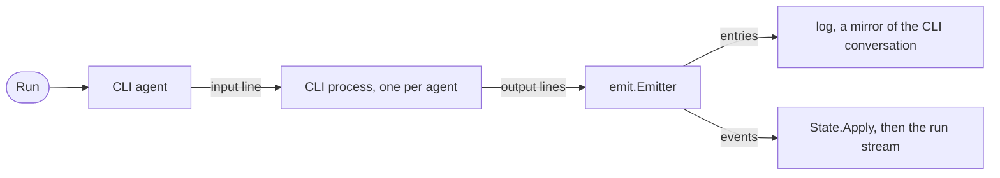

# CLI Agent

A CLI agent runs an agent CLI as a gopi agent. The CLI calls the model and runs the tools in its own loop. The CLI agent turns its output into the events of a run stream, the entries of a log, and a [State](state.md).

## Design

- A CLI agent is an agent, because the CLI runs tools and does not answer one model call. It has the same `Run`, `Log`, `State`, and run stream as `agent.Agent`, so a consumer needs no second path.
- Each CLI has its own package and its own type, and a [driver](driver.md) starts each agent. An option that both packages have has the same name in both.
- The CLI owns the conversation. The [emitter](cli-emitter.md) writes a mirror of it to the log, for display and replay, and the model never reads the log.
- The ID of the CLI conversation is a session value, so `Durable` resumes the same conversation. Each agent reads and writes it only through `internal/resume`, and a caller never sees it.
- If the CLI cannot find the stored conversation, the run fails with `ErrNoConversation`, and the agent clears the ID. The next run starts a new conversation of the CLI, and the log keeps its messages.
- The CLI runs only its own tools, so a CLI agent has no `Toolset` option.
- One process lives as long as the agent: the first run starts it, and `Close` stops it. Each run after the first then starts with no handshake.
- The packages speak the protocols of the IDE extensions, `codex app-server` and the stream-json mode of `claude`. These protocols interrupt a turn and carry the [requests of the CLI](cli-request.md).
- A cancel interrupts the turn and waits for the end of the turn, so the next run starts from a known state. The agent kills the process only after a timeout.
- A CLI that is not logged in fails the run with `ErrAuth`, so a caller can ask the user to log in.
- The tests replay the stdio of the CLI from a trace with `internal/stdiorr`, and `make record-cli` records a trace from the real CLI.

## Map

| Task                                        | File                              |
| ------------------------------------------- | --------------------------------- |
| Change how a CLI process starts or stops    | `pkg/agent/internal/cliproc/cliproc.go` |
| Change where a CLI keeps its conversation ID | `pkg/agent/internal/resume/resume.go` |
| Change how stderr reaches an error          | `pkg/agent/internal/tail/tail.go` |
| Record or replay a trace                    | `internal/stdiorr/rr.go`          |

## Related Concepts

- [Loop](loop.md)
- [Durability](durability.md)
- [CLI Emitter](cli-emitter.md)
- [CLI Steer](cli-steer.md)
- [CLI Request](cli-request.md)
- [Log](../session/log.md)
- [Value](../session/value.md)
