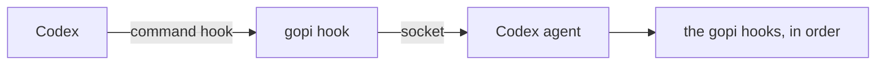

# CLI Request

A CLI asks its [CLI agent](cli-agent.md) during a turn: an approval of a tool call, or a call of a hook. The agent answers an approval with the approve function, and a hook call with the gopi hooks. Claude Code sends each request over its control protocol. Codex sends an approval over its protocol, and a hook call through the `gopi hook` command.

## Design

- The agent answers every request of the CLI, and an unknown request gets an error. The CLI waits for an answer, so a request with no answer stops the turn.
- Both agents take the approve function of the harness, `agent.ApproveFunc`, so one function answers the approvals of each agent. The function gets the tool call as the log has it, so a rule for the log matches the approval too. Without an `Approve` function, the agent declines each approval.
- Codex cannot change the input of an action or send a reason to the model, so the Codex agent declines a changed input and drops the reason.
- The Codex approve function runs in its own goroutine, so the reader goes on while a caller decides.
- Claude Code calls the gopi hooks over the control protocol. The agent registers one callback for each hook event in `initialize`, so the CLI runs no command and needs no trust for a hook.
- Codex has no hook callback over its protocol, so the agent adds a command hook to the thread through the config of `thread/start`, with the hook trust bypassed.
- If `gopi hook` fails or times out, Codex runs the tool. So the agent finds the command before it starts the process, and a run with hooks fails if the command is missing. If the command cannot reach the agent, it fails closed: a deny, an error output, or the end of the turn.
- A hook of a CLI agent gives text entries only, because a CLI takes only text context from a hook. A CLI has no hook at a model call, so its driver rejects `BeforeCall` and `AfterCall`.

## Map

| Task                                       | File                          |
| ------------------------------------------ | ----------------------------- |
| Change a control request of Claude Code    | `pkg/agent/claude/process.go` |
| Change how Claude Code calls a hook        | `pkg/agent/claude/hooks.go`   |
| Change the Codex handshake or a request    | `pkg/agent/codex/conn.go`     |
| Change how Codex calls a hook              | `pkg/agent/codex/hooks.go`    |
| Change the relay of `gopi hook`            | `cmd/gopi/hook.go`            |

## Related Concepts

- [CLI Agent](cli-agent.md)
- [Driver](driver.md)
- [Loop](loop.md)
- [Permission](../harness/permission.md)
