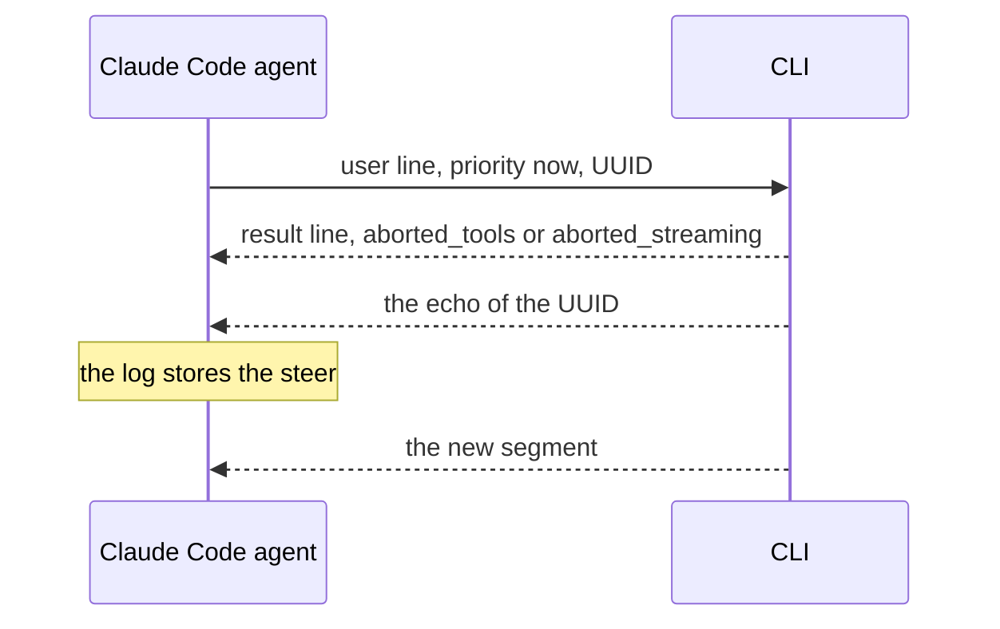

# CLI Steer

The Claude Code agent is a steerer: a steer reaches the CLI during a run, and the model reads it before its next call. The Codex agent is not a steerer.

## Design

- A steer goes to the CLI at once, with the priority `now`. A tool that runs in the foreground ends first, and the steer takes effect before the next model call.
- A result line that a steer causes does not end the run. The usage of the run is the sum of its result lines: one for each segment that a steer ended, and the last line.
- The agent starts the CLI with `--replay-user-messages`, so the CLI echoes the UUID of a steer when it takes it. The log stores the steer at the echo, which is the point where the model reads it.
- A steer cancels a subagent that runs in the foreground, so the agent first moves each open subagent call to the background with a `background_tasks` request. The steer waits for the answers until `moveTimeout` ends.
- If a run ends before the CLI takes a steer, the agent stops the CLI, so the CLI does not run the steer after the run. `TakeSteer` returns the steer, and the [host](../host/host.md) runs it next.
- The host holds a message for Codex until the run ends, because the Codex agent is not a steerer.

## Map

| Task                                    | File                         |
| --------------------------------------- | ---------------------------- |
| Change how a steer reaches Claude Code  | `pkg/agent/claude/steer.go`  |
| Change the flags of the CLI             | `pkg/agent/claude/claude.go` |
| Change how a host steers or holds a message | `pkg/host/run.go`        |

## Related Concepts

- [CLI Agent](cli-agent.md)
- [Loop](loop.md)
- [Subagent](subagent.md)
- [Host](../host/host.md)
