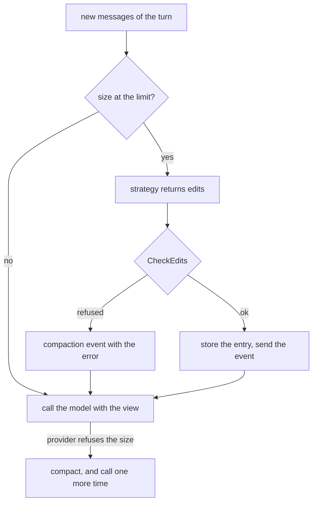

# Compaction

A compaction replaces ranges of old messages in what the model reads. A strategy returns edits, the log stores them as one custom entry, and `State.View` applies them for each request. The log and `State.Messages` keep each original message.

## Design

- The state keeps the full history, and only the request uses the view. So the sections, the tools, and the search reload read the same system messages after a compaction.
- An edit names entries by ID, because a message has no ID. An edit addresses ranges and not indexes, so a compaction stays valid when it runs next to later messages.
- A replacement gets the ID `First.N`, so a later edit can name it. The log sets the ID of an entry at the append, so a replacement ID cannot use the ID of its compaction.
- A system message or an ephemeral entry in a range stays after the replacement. The cost: the order of the view differs from the order of the log.
- `CheckEdits` refuses an edit that breaks a request: a call with no result, a result with no call, or a change to the base. It also refuses a replacement with a thinking block, because a signature is valid only for the original message.
- An edit changes the prefix of each later turn, so Anthropic drops the thinking of those turns: the provider sends the `drop_block` control, and the request passes. The cost: the model loses that reasoning, and it keeps the text and the tool calls.
- A compaction blocks the next model call. The cost: a summary can take a minute with no message event, so `compaction_start` tells a viewer that the agent is working.
- A failed compaction does not stop a run, because the old view is still valid. The loop tries again after the size grows by 10%, so a fault does not cost money on each call.
- If a provider refuses the size, the loop compacts and calls one more time. The same prefix does not fit a side call either, so a strategy then reads the history as serialized text.
- The size comes from the usage of the last call after the last compaction. An older call reports the old size, so with no later call the size is an estimate of the view.
- A strategy uses the prefix of the agent by default, so its call reads the prompt cache. The edit still breaks the prefix from the earliest edit, and the next call writes the cache from there.
- A custom model reads serialized text and no cache, because a prefix belongs to one model.
- A driver of a CLI ignores the strategy, because the CLI compacts its own session.
- The user message rules of the `Summarize` prompt come from Claude Code.

## Map

| Task                                       | File                              |
| ------------------------------------------ | --------------------------------- |
| Change when the loop compacts              | `pkg/agent/compact.go`            |
| Change how edits apply, or what is refused | `pkg/session/compaction.go`       |
| Change the summary or its cut              | `pkg/agent/compact/summarize.go`  |
| Change serialized text or clipping         | `pkg/agent/compact/model.go`      |
| Map the size error of a provider           | `internal/retry/retry.go`         |

## Related Concepts

- [Loop](loop.md)
- [State](state.md)
- [Durability](durability.md)
- [Log](../session/log.md)
