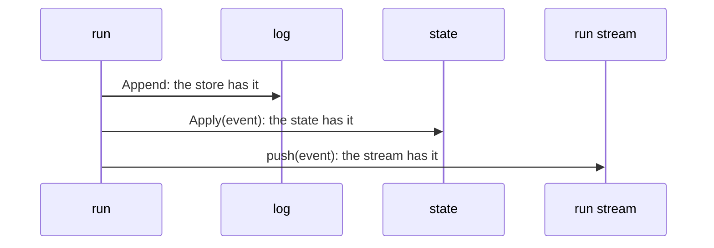

# Durability

A run is durable: each message goes to the [log](../session/log.md) before its event, so a crash loses at most the message in flight. `Durable` opens a session in a store and resumes it after its last entry. `New` runs the same loop over a log in memory.

## Design

- One function commits each entry under one lock, so a consumer that reads a `message_end` knows that the store has the message. If the store fails, the state and the stream do not get the message, and the run fails.
- The append ignores the cancel of the run, so a run that stops keeps the messages that it finished, the partial message of an aborted call included.
- Each result of a batch is stored as its call ends, so a crash or a cancel keeps each result that finished. The cost: the results are in the order in which the calls end, not in call order.
- A call with no result gets the error result "tool execution interrupted", because a provider rejects a call with no result. On a resume, the log repairs it when it builds the messages. In the same process, the first turn of the next run stores it with its events, so a viewer sees it.
- `Durable` reads the log once, and then the state holds the messages, so a run reads no store. The cost: an entry that a caller appends to the log directly reaches the model only after the next `Durable`.
- A resumed agent reads its tools and sections from the system messages of the log, so the model keeps the prompt that it read. The next run adds a change only if the new agent wants other tools or sections.
- `Durable` runs each search of the log again, so a resumed agent can call each tool that a search loaded. A crash between a search result and the next model call loses the change that declares the tools. The search is pure, so a second run loads the same tools.
- The steer and follow-up queues live in memory, so a crash loses them. No fsync runs, so a crash of the OS can lose the last entries that the store wrote.

## Map

| Task                                             | File                    |
| ------------------------------------------------ | ----------------------- |
| Change the order of the store, the state, and the stream | `pkg/agent/agent.go` |
| Change how a run stores a message                | `pkg/agent/loop.go`     |
| Change how a batch stores its results            | `pkg/agent/toolcall.go` |
| Change what a resumed agent loads                | `pkg/agent/tools.go`    |

## Related Concepts

- [Loop](loop.md)
- [State](state.md)
- [Log](../session/log.md)
- [Store](../session/store.md)
