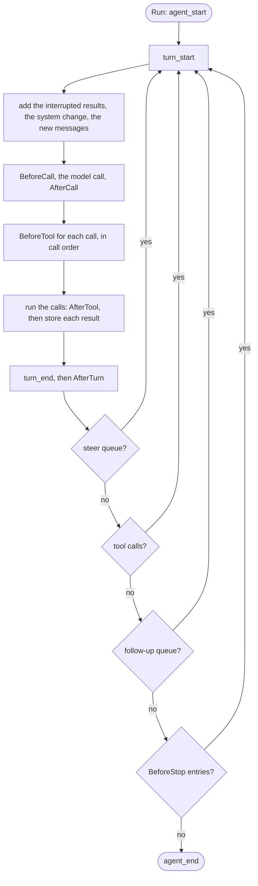

# Loop

An agent is the loop that runs a model with tools until the work is done. It stores each message in its [log](../session/log.md) as the message completes, then adds it to the history.

## Design

- The agent has an option for each setting that every call needs: `MaxTokens` and `Thinking`. A `BeforeCall` hook sets any other option of a call, such as `ai.Temperature` or `ai.CacheRetention`, in `Request.Options`. A new option in `pkg/ai` then needs no change here.
- The tool calls of one message run at the same time, so the slowest call sets the time of the turn. If a message calls a sequential tool, every call of the message runs in order.
- A Go error from a tool or a tool hook, or an unknown tool, becomes an error result, so the model can correct the call. A canceled or expired context stops the run, because the caller asked for it.
- A finished tool call runs whatever the stop reason, except a refusal. A provider can stop at the output cap after a complete call, and a call that does not run gives the model no result.
- Each hook point is its own interface, such as `BeforeToolHook`, so a hook at two points is one value, and a driver sees the points that a hook uses. The cost: a misspelled method compiles and never runs.
- The `BeforeTool` hooks run one call at a time, before the calls start. A hook that asks a person to approve a call then asks one question at a time.
- `BeforeStop` is the one hook that continues a run, so one place decides the stop. The agent has no turn cap, so a run stops early in one way: a `BeforeCall` hook that reads `State.Turn` returns an error.

## Map

| Task                                                        | File                    |
| ----------------------------------------------------------- | ----------------------- |
| Add an option                                               | `pkg/agent/agent.go`    |
| Change when a turn ends, a run stops, or a queue is drained | `pkg/agent/loop.go`     |
| Change how the model is called                              | `pkg/agent/call.go`     |
| Change how a tool call runs or its result is built          | `pkg/agent/toolcall.go` |
| Add a hook or change its input                              | `pkg/agent/hooks.go`    |

## Related Concepts

- [Durability](durability.md)
- [Run Stream](run-stream.md)
- [State](state.md)
- [Log](../session/log.md)
- [Tool](../tool/tool.md)
- [Tool Change](tool-change.md)
