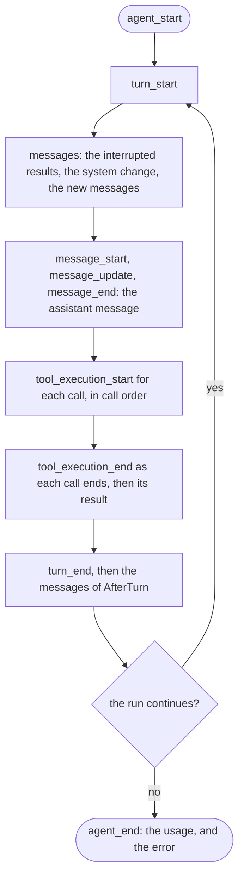

# Run Stream

A run stream is the events of one run, read in order, followed by the messages that the run produced. It is the generic stream of `pkg/stream`, with an agent event and a message list as its types.

## Design

- Each event is one change to the state of the agent. The stream sends the events, also those of tool calls at the same time, in the order that the state applied them, for the reasons in [State](state.md).
- The log stores each message before its `message_end`, so a consumer that reads a `message_end` knows that the store has the message. An ephemeral message has the `Ephemeral` mark, because the store does not have it.
- The run waits for the consumer only when the stream buffer is full. A consumer that stops reading does not stop the run, and the log still has the messages.
- The new messages of a turn, with the input of the run, come after its `turn_start` as message events, so a viewer that has only the stream sees every message that the run adds to the history.
- On every exit, the loop sends the end event of each open scope, then `agent_end` with the error of a failed run. A failed run then fails the stream with the same error.
- Runs on one agent are sequential, so two runs never add to one log at the same time.
- A failure that cuts an assistant message short sends its `message_end` with the part that arrived, without the tool calls that did not finish. Its stop reason is `error`, or `aborted` if the caller canceled. If the part has content, the log keeps it.
- Each `tool_execution_end` comes as its call ends, so a consumer can show a call as done before the others. With calls in order, each call sends its start, its end, and its result before the next call starts.
- `agent_end` carries the usage and no messages, because the state and the result of the stream have them.
- A tool call that runs a [subagent](subagent.md) adds the subagent events. A consumer that does not show subagents skips them.

## Map

| Task                                | File                   |
| ----------------------------------- | ---------------------- |
| Read the event types                | `pkg/agent/event.go`   |
| Change when an event is sent        | `pkg/agent/loop.go`    |
| Change how a stream delivers events | `pkg/stream/stream.go` |

## Related Concepts

- [Loop](loop.md)
- [State](state.md)
- [Subagent](subagent.md)
- [Log](../session/log.md)
- [Stream](../ai/stream.md)
