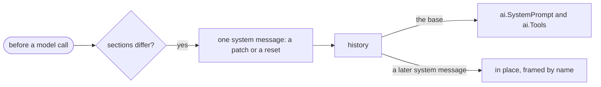

# Section

A section is a named part of the system prompt. A system message sets a section or removes it, from its place in the conversation.

## Design

- A section is a content block of a system message, so the history keeps the order of the sections. A removal is its own block, `SectionRemoved`, because a section with an empty text is a valid section.
- The agent has one prompt option, `System`, and its function returns the sections. The whole prompt then lives in the history, and the log records the prompt that the model read.
- The change goes before the new messages of the turn, so the model reads the prompt before the messages that it applies to.
- The base never changes, so the cached prefix stays across a change, and a change costs only the tokens of its system message. The prefix changes on a call where a provider sends a new tool list, as [Tool Change](tool-change.md) shows.
- The agent folds the sections, and a provider does not, because only the agent compares the history with the sections that it wants. A provider adds only the frame of [Message](../ai/message.md), so a tag or a heading in the text is the choice of the caller.
- A reset is longer than a patch, but the model then reads one order.
- An agent without `System` leaves the sections of the history, so it removes nothing that another agent wrote.
- An agent CLI gets the text of the base as its prompt at each start, so a resumed CLI gets the same prompt, and the cache of the conversation stays.
- A CLI reads a change only at the next run. Claude Code takes no system message in a conversation, so a change goes as a `<system-reminder>` block before the input.
- Codex gets a change as a developer message before the next turn. A Codex model reads a developer message over an older user message, so a change in a user message holds only for its own turn.
- After an agent CLI compacts its conversation, the model can lose a change, because the summary replaces the reminders.

## Map

| Task                                              | File                           |
| ------------------------------------------------- | ------------------------------ |
| Change the section blocks                         | `pkg/ai/content.go`            |
| Change the fold or the change blocks              | `pkg/agent/internal/sections/sections.go` |
| Change when the native agent writes a change      | `pkg/agent/system.go`          |
| Change how a CLI agent sends the base or a change | `pkg/agent/claude/claude.go`, `pkg/agent/claude/background.go`, `pkg/agent/codex/codex.go` |
| Change how a provider sends a system message      | `pkg/ai/<provider>/convert.go` |

## Related Concepts

- [Tool Change](tool-change.md)
- [Message](../ai/message.md)
- [Loop](loop.md)
