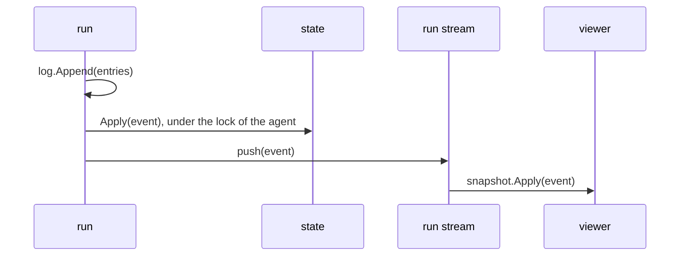

# State

The state of an agent is what it knows: the messages that the model reads, the progress of the run, the queues, and the loaded tools. The messages start with the messages of the log. After that, only an event changes the messages and the progress of a run.

## Design

- `Apply` is the one function that changes the messages and the progress, and each change is an event. A test proves that a viewer gets the same state as the agent when it applies every event of each run to a snapshot. If the viewer breaks out of a stream, the stream drops the later events, and the viewer misses their changes.
- The messages that `Durable` reads from the log have no event, so a run does not send the whole conversation to each viewer. A viewer starts from a snapshot that it takes when no run is active. A snapshot from a run holds events that the stream has not delivered, so the viewer applies them two times.
- A hook gets the state, so it reads what the model reads, with the pending calls. If a `BeforeCall` hook changes the messages of a request, the model reads messages that the state does not hold.
- An ephemeral message stays in the messages until `agent_end`, which removes it. Its `message_end` carries the mark, so a viewer removes it too, and after a run the messages are the messages of the log.
- A copy of the state shares its messages with the agent, so a copy costs no allocation. The cost: a caller must not change a message of a copy, and Go cannot enforce it.
- The state reads the tools and the sections from the system messages, so they need no event.
- An assistant message with no content, such as one that a failure ends before its first block, does not go into the messages, because a provider rejects it.
- The JSON of the state leaves out the queues, the loaded tools, and the log, because no event changes them.
- Every copy of the state points to the queues of the agent, so a hook steers with `State.Steer` and `State.FollowUp` and needs no reference to the agent. The cost: a state is a value with two methods that change the agent. A decoded state has no queues.

## Map

| Task                                   | File                 |
| -------------------------------------- | -------------------- |
| Change what an event does to the state | `pkg/agent/state.go` |
| Change how the loop sends an event     | `pkg/agent/agent.go` |
| Change what a hook reads               | `pkg/agent/hooks.go` |

## Related Concepts

- [Run Stream](run-stream.md)
- [Loop](loop.md)
- [Log](../session/log.md)
- [Value](../session/value.md)
