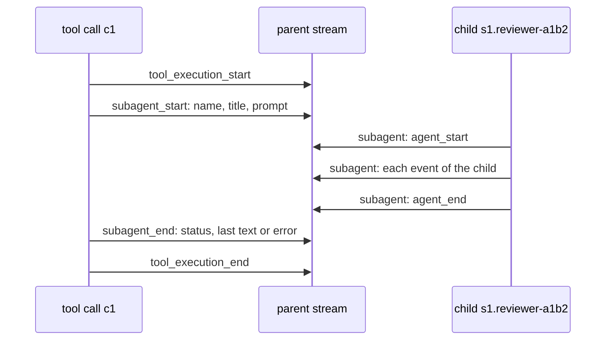

# Subagent

A subagent is an agent that one tool call of a parent starts: the agent tool of the harness, the Agent tool of Claude Code, or spawn_agent of Codex. Each subagent has a child session, and the run stream of the parent carries its events.

## Design

- A child keeps its messages in its own session, and its parent session and tool call in the `Parent` value. The link is data, so a store needs no folder layout to keep it.
- The ID of a child is the parent ID, ".", the name, "-", and a suffix. A driver takes the suffix from the native ID of the subagent if it has one, so that a replay of the same output finds the same child.
- The parent stream wraps each event of a child in a `subagent` event, so a viewer of the parent sees the child live, with no second stream. The order rules of a run apply inside each child, and not across the parent and the child.
- The host makes each child a read-only [child session](../host/child-session.md).
- Each `subagent_start` has one `subagent_end` in the same run: a run that stops ends each open child as `interrupted`, so a viewer never keeps a child open.
- The text of `subagent_end` is the last text of the child, or the error of a child that failed. Each driver and the agent tool fill it the same way, so a viewer reads one field.
- A Claude Code child can go on after the run that started it, because the CLI keeps background tasks. That run ends the child with the status `background`, and a later run sends a new `subagent_start` for it.
- A Codex run waits for its children, because the Codex server starts no turn when a child ends. The run gives the model the results of the late children in a report turn. A report turn can start more children, so the run waits again after it.
- The wait for a Codex child has no time limit, because a child can work for a long time, and a stop of the run ends it.

## Map

| Task                                       | File                       |
| ------------------------------------------ | -------------------------- |
| Read the subagent events and the value     | `pkg/agent/subagent.go`    |
| Change how a tool call gets its sink       | `pkg/agent/toolcall.go`    |
| Change how Claude Code lines reach a child | `pkg/agent/claude/subagent.go` |
| Change how Claude Code reads between runs  | `pkg/agent/claude/background.go` |
| Change how Codex threads reach a child     | `pkg/agent/codex/subagent.go` |

## Related Concepts

- [Run Stream](run-stream.md)
- [CLI Agent](cli-agent.md)
- [Child Session](../host/child-session.md)
- [Agent Tool](../harness/agent-tool.md)
- [Value](../session/value.md)
