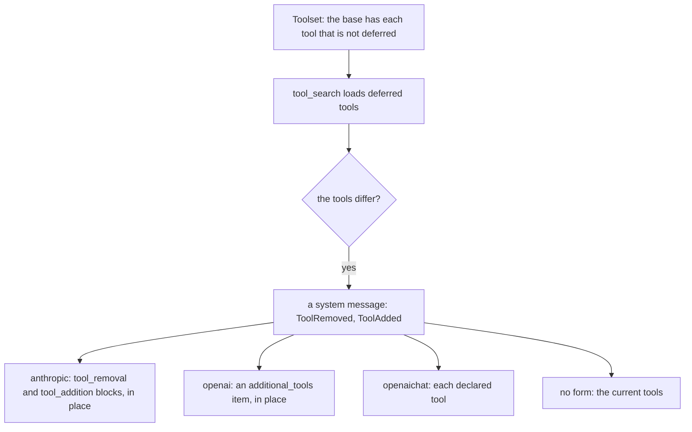

# Tool Change

A tool change adds or removes tools that the model can call, from a place in the conversation. The search tool loads a deferred tool.

## Design

- A change is a system message, and the base stays the same, as in [Section](section.md). A deploy that changes a tool then keeps the cache of a resumed session. The cache misses on a call where the provider sends a new tool list.
- The history declares the tools that the model can call. The search keeps the loaded tools in the agent, so only the next model call writes a change.
- The agent and each provider fold the tools with `transcript.CurrentTools`, so they agree on the tools at each place. The fold is in `internal/transcript`, because `pkg/ai` holds no conversation state.
- If a tool of the history is not in `Toolset`, the next call removes it, so the model never sees a tool that is gone. This is the one source of a removal.
- A deferred tool is in the one `Toolset`, with a flag on its info, so the agent has one rule for names and order.
- The search is a tool of the agent, because it changes the tools that the agent declares. Only the search loads a tool.
- `Toolset` is fixed at `New` or `Durable`, so a provider caches the description of the search, which names each deferred tool. The cost: each name costs tokens. An agent with other deferred tools replaces the search tool in a resumed session.
- The search matches a query by name or by keyword in the process, so it works with every provider. The cost: a synonym of a word of a tool does not match.
- The loaded tools outlive the run, because a failure or a cancel can end a run between the search and the next model call. The next run then declares them, so the model can call a tool that the search told it about.

## Map

| Task                                    | File                                        |
| --------------------------------------- | ------------------------------------------- |
| Change the base                         | `pkg/agent/system.go`                       |
| Change the fold of the tools            | `internal/transcript/transcript.go`         |
| Change when the agent declares a change | `pkg/agent/tools.go`, `pkg/agent/system.go` |
| Change how a provider sends a change    | `pkg/ai/<provider>/convert.go`, `params.go` |
| Change the search or the ranking        | `pkg/agent/search.go`                       |
| Change the deferred flag                | `pkg/tool/tool.go`, `pkg/ai/tool.go`        |

## Related Concepts

- [Loop](loop.md)
- [Message](../ai/message.md)
- [Tool](../tool/tool.md)
- [Durability](durability.md)
