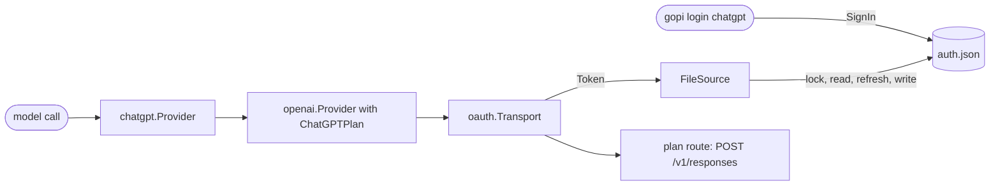

# ChatGPT Plan

The `chatgpt` provider runs a model call on the ChatGPT plan of a user, with no API key. It signs in with Sign in with ChatGPT, keeps the account in a login file, and sends each call through the `openai` provider with `openai.ChatGPTPlan`. The call goes to the plan route: the Responses API of api.openai.com, with an OAuth token of the plan.

## Design

- The first sign-in registers gopi, and each later sign-in and sign-out keeps that registration. A new registration stays on the account of the user until the user removes it.
- The loopback listener binds 127.0.0.1, not localhost, because OpenAI refuses localhost in a redirect URI. Only the port of the redirect URI can change between sign-ins, so `gopi login` uses one port.
- The refresh is in the source of the token, not in the transport. The transport asks for a token before each request and keeps none, so one source can serve many providers.
- The refresh token rotates on each refresh, so two processes that send the same refresh token lose one sign-in. `FileSource` takes a lock on the login file, reads the file again, and refreshes only if the token in the file is still not valid.
- `openai.ChatGPTPlan` removes the request fields that the plan route refuses, puts the function tools in one namespace, and streams an object call, because the route refuses a function tool outside a namespace and a call that does not stream.
- gopi has no sign-in for a Claude plan. Anthropic does not let another app offer a Claude.ai login or send calls with the credentials of a plan. A Claude plan runs through the claude-code driver, and the API credits of a plan work through an API key.
- The CLI puts the detector of the login before the detectors of package env. A sign-in is a choice of the user, so the default model of gopi then comes from the plan.

## Map

| Task                                         | File                          |
| -------------------------------------------- | ----------------------------- |
| Change the sign-in, the refresh, or sign-out | `pkg/ai/chatgpt/auth.go`      |
| Change the check of the ID token             | `pkg/ai/chatgpt/idtoken.go`   |
| Change the login file or its lock            | `pkg/ai/chatgpt/store.go`     |
| Change how a model of the plan lists         | `pkg/ai/chatgpt/chatgpt.go`   |
| Change what a request on the plan sends      | `pkg/ai/openai/plan.go`       |
| Change the loopback listener or PKCE         | `pkg/ai/oauth/callback.go`, `pkg/ai/oauth/oauth.go` |
| Change gopi login or gopi logout             | `cmd/gopi/login.go`           |

## Related Concepts

- [OpenAI Providers](openai.md)
- [Host Provider](host-provider.md)
- [Provider](provider.md)
- [Catalog](../catalog/catalog.md)
