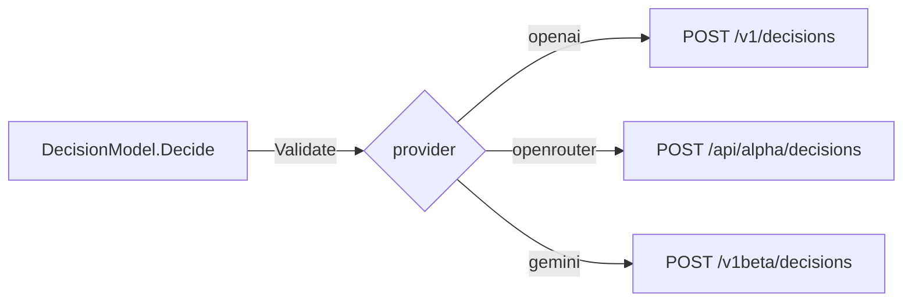

# Decision

A decision is one model call that asks closed questions about one input. The model scores the possible answers in one pass and returns their probabilities. It generates no text, so most of its cost is input tokens.

## Design

- `ai` has one question shape for each API, with four kinds: yes or no, choice, score, and box. Each provider maps a kind to the name of its API. So the code of a caller moves to another provider with a change of the spec only.
- `DecisionModel.Decide` checks the rules that each decisions API shares, so no provider repeats them. A limit of one API stays with the provider of that API.
- A provider returns the answers as the API gives them, with the kind that the API gives. Then `Decide` checks them, so a missing answer fails the call. A zero probability must not stand for an answer that the API did not give.
- If a provider cannot send a question kind or a file, the call fails with `errors.ErrUnsupported`, and the provider sends nothing. An OpenRouter model that takes no box question fails with HTTP 400, because the provider cannot tell that error from another 400.
- The input is a list of messages, so the transcript of an agent goes as it is. Each provider drops the thinking blocks, because no decisions API reads reasoning. The system messages obey the order of [Message](message.md).
- The OpenAI API has no field for the outcome text of a yes-or-no question. So `openai` adds a "Yes:" line and a "No:" line to the instructions.
- The Gemini API reads content items only, with no tool items. So `gemini` sends each tool call and tool result as text that names the tool.
- A decision model of OpenRouter has the output `decisions` only, so the catalog does not bind it as a language model. The rule is in [Catalog](../catalog/catalog.md).
- `Detect` of the catalog registers a provider for decisions if it implements `ai.DecisionProvider`. So a provider with text and decisions needs no second detector.

## Map

| Task                                        | File                              |
| ------------------------------------------- | --------------------------------- |
| Change a question kind or a shared rule     | `pkg/ai/decision.go`              |
| Change the request of OpenAI                | `pkg/ai/openai/decision.go`       |
| Change the request of OpenRouter            | `pkg/ai/openrouter/decision.go`   |
| Change the request of Gemini                | `pkg/ai/gemini/decision.go`       |
| Change the answers of OpenRouter and Gemini | `internal/decisionwire/decisionwire.go` |
| Add a case that each provider must pass     | `internal/providertest/fake.go`   |
| Resolve a spec to a decision model          | `pkg/catalog/catalog.go`          |
| List the decision models of OpenRouter      | `pkg/ai/openrouter/list.go`       |
| Change the output of `gopi decide`          | `cmd/gopi/decide.go`              |

## Related Concepts

- [Provider](provider.md)
- [Host Provider](host-provider.md)
- [Message](message.md)
- [Catalog](../catalog/catalog.md)
