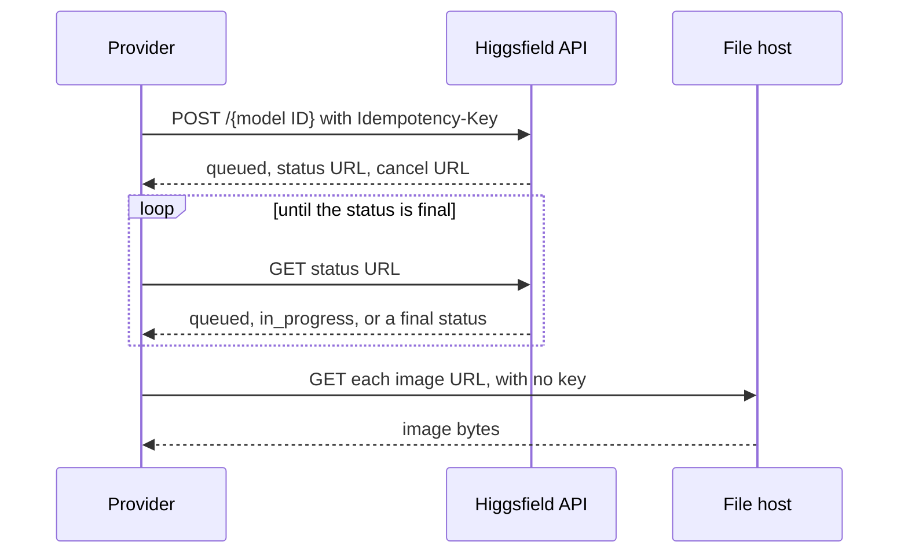

# Higgsfield Provider

The Higgsfield provider generates images with the SOUL models of the Higgsfield API. It uses plain HTTP requests. It has image generation and a fixed model list, and no text generation. The API is asynchronous, so one image call waits for its request to end.

## Design

- A model ID is the path of its submit endpoint, such as `higgsfield-ai/soul/v2/standard`. The API has no models endpoint, so the model list is fixed in the code.
- The key is one string, `id:secret`. The provider sends it in the `Authorization` header with the `Key` scheme. The owner pastes one value, and the SDKs of Higgsfield read one value.
- A submit sends a new `Idempotency-Key`, and each retry of the submit sends the same key. As a result, a lost answer does not start and charge a second generation.
- The provider reads the status URL and the cancel URL from the submit answer. It does not build them from the base URL.
- A call returns when its images are ready, or when a cap in the code ends the wait. The result is one `ai.ImageResponse`, the same as a sync provider. The cost is a call that can take minutes.
- If the context of a call ends while the request is queued, the provider cancels the request. The API cannot cancel a request after it starts, so an in-progress request runs to its end.
- The provider maps each size option to the nearest value that the SOUL models take. The models take no pixel size, so `ai.ImageSize` has no effect. The models make batches of 1 or 4 only, so a count of 2 or more gives 4 images.
- The provider downloads each image and returns its bytes, because the API deletes the files when the retention period of the request ends. A download sends no key, because the files are on another host.
- The provider has no key check, because the API has no read call that runs no model.
- Each submit and each status read goes through `internal/retry`. A failed answer is an `*Error` with the status, the header, and the start of the body.

## Map

| Task                                        | File                              |
| ------------------------------------------- | --------------------------------- |
| Change the key, the base URL, or the client | `pkg/ai/higgsfield/higgsfield.go` |
| Change the retries or read an error         | `pkg/ai/higgsfield/request.go`    |
| Map the options, wait, or download          | `pkg/ai/higgsfield/image.go`      |
| Add a model                                 | `pkg/ai/higgsfield/list.go`       |

## Related Concepts

- [Provider](provider.md)
- [Catalog](../catalog/catalog.md)
