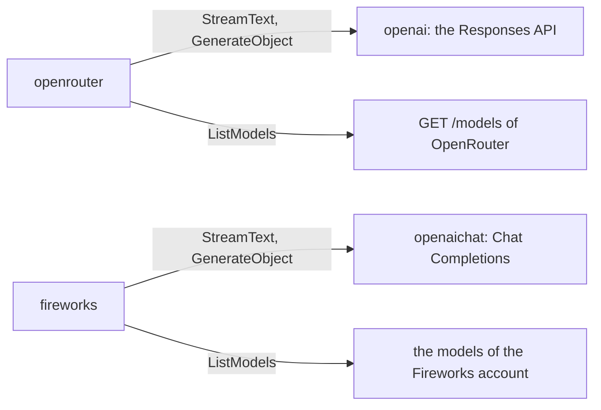

# Host Provider

A host provider is a provider for one server that copies an OpenAI API. It sends each model call through the provider of that API, and it adds what the server does differently: its key, its URL, and its model list. `openrouter` sends its calls through `openai`, and `fireworks` sends its calls through `openaichat`.

## Design

- The request, the stream, the retries, and the conversion of the messages stay in the provider of the API. A host provider adds no second copy of them, so a fix to the API provider fixes each host.
- A host provider has only the text call, the object call, and the model list. The image call and the token count call of `openai` go to APIs that OpenRouter does not serve, so `Detect` does not register a host provider for images.
- A host provider always gives its own key and base URL to the API provider. Without them, the OpenAI SDK reads `OPENAI_API_KEY` and `OPENAI_BASE_URL`, and sends the OpenAI key to another server.
- The model list of each host has more fields than the model list of OpenAI, which has only IDs, so a host provider reads the model list of the host. The default models of each host are in the [model file](../catalog/model-data.md).
- OpenRouter gives a price for one token, and gopi keeps a price for one million tokens. The provider rounds the product to six decimal places, so a price has no float error.
- The model list of Fireworks is on its control plane, at the root of the API, so the base URL of `fireworks` is the root URL.
- The model list of Fireworks has no output cap, so a model that `ListModels` returns has no `MaxTokens`. The models of Fireworks in the model file come from models.dev, with their caps.
- Each model list keeps only the models with tools, because each call of a gopi agent sends tools.
- A fetch keeps the registered prices of a model, by the merge rule of the [catalog](../catalog/catalog.md).

## Map

| Task                                    | File                          |
| --------------------------------------- | ----------------------------- |
| Change how a model of OpenRouter lists  | `pkg/ai/openrouter/list.go`   |
| Change how a model of Fireworks lists   | `pkg/ai/fireworks/list.go`    |
| Change the key or the URL of a host     | `pkg/ai/<host>/<host>.go`     |
| Add a host to the built-in detectors    | `pkg/catalog/env/env.go`      |
| Change how a listed model merges        | `pkg/catalog/fetch.go`        |

## Related Concepts

- [Provider](provider.md)
- [OpenAI Providers](openai.md)
- [Catalog](../catalog/catalog.md)
