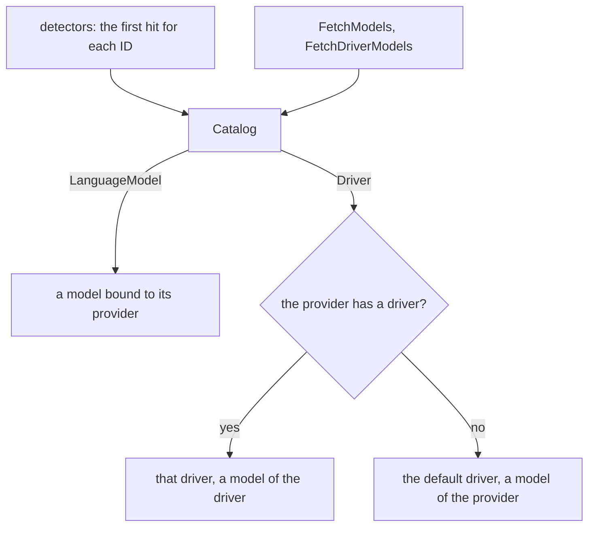

# Catalog

A catalog maps a spec to a model bound to its provider, or to the [driver](../agent/driver.md) that starts its agent. A spec is `<provider>/<model-id>`, or a bare model ID. A detector reads one source and gives the catalog a provider or a driver: an API key for a provider, and a CLI on the PATH for a driver.

## Design

- Each capability has its own register method, so a provider of the wrong type fails at compile time and not at the call.
- A spec names a registered model, so a typo fails when the catalog resolves it, and not at the API after a call with no prices.
- A bare model ID resolves only when one provider registered it, because a silent choice can send a call to the wrong account.
- The models of the drivers are separate from the models of the providers, because a driver cannot serve a call to a model. A CLI and its model API often share a model ID, and each keeps its own metadata.
- A driver is one more capability, so one spec names both the kind of agent and its model, such as `claude-code/claude-opus-5-5`.
- Detection is in the detectors, not in the provider packages, so one credential serves two IDs, such as `openai` and `openaichat`.
- `pkg/catalog/env` is its own module, because it imports each provider module. A program that registers its own providers then downloads no SDK of a provider.
- `FetchModels` merges a model list into the registered models, field by field. A zero field keeps the registered value, because the OpenAI API lists only IDs. The registered prices stay, because a person checks them in the [model file](model-data.md).
- `FetchDriverModels` lists the models of the drivers, and `FetchModels` does not, because a driver starts its CLI to list, and the CLI runs the hooks of its settings.
- The catalog fetches a model list only when a caller asks, so detection makes no network call.
- The package holds no catalog of its own, so a call shows which credentials it uses, and two tests do not share a catalog.

## Map

| Task                              | File                             |
| --------------------------------- | -------------------------------- |
| Change how a spec resolves        | `pkg/catalog/catalog.go`         |
| Change the order or the skip rule | `pkg/catalog/detect.go`          |
| Change how a model list merges    | `pkg/catalog/fetch.go`           |
| Add a built-in credential source  | `pkg/catalog/env/env.go`         |
| Add a built-in CLI                | `pkg/catalog/env/env.go`         |

## Related Concepts

- [Model Data](model-data.md)
- [Provider](../ai/provider.md)
- [Driver](../agent/driver.md)
