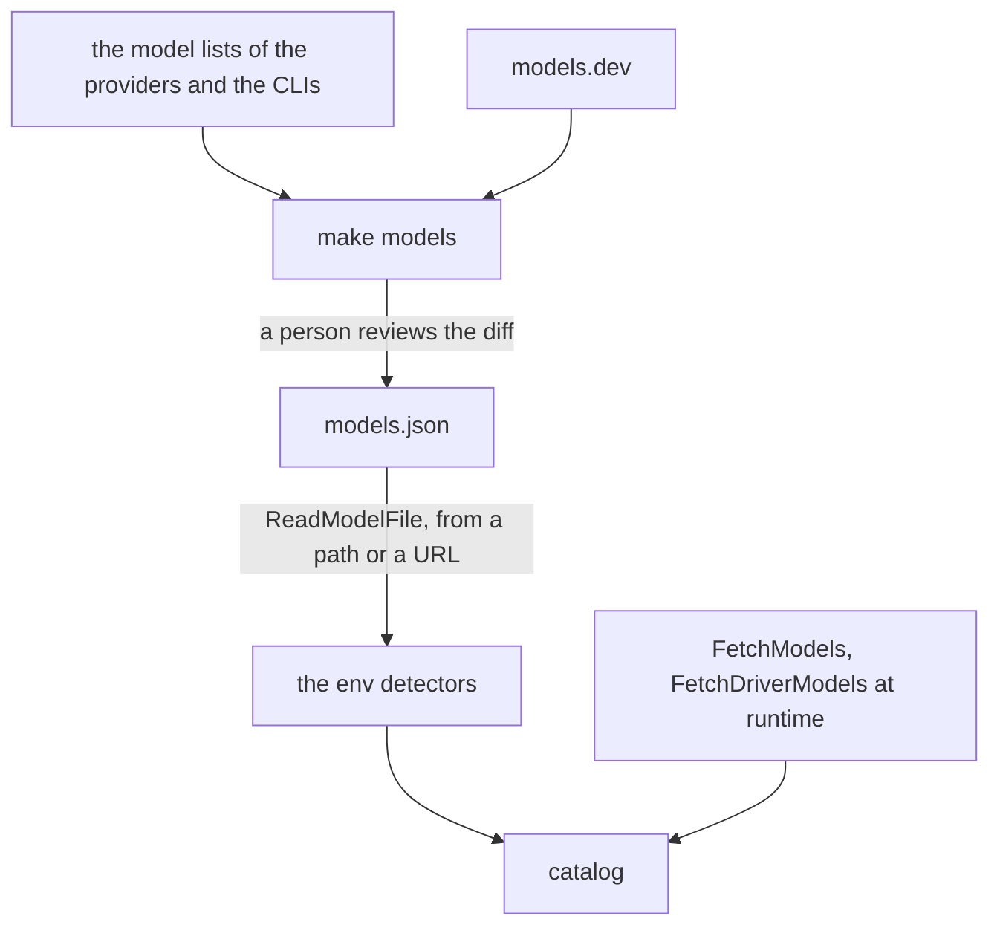

# Model Data

The model data of gopi is the model file, `models.json`, at the root of the repository. It holds the default models of each provider and each driver, keyed by the ID of its detector. `make models` writes the file, and a program reads it with `catalog.ReadModelFile`. The meaning of each field is in the doc comments of `ai.Model`, `ai.Pricing`, and `modelsfile.Entry`.

## Design

- gopi does not embed the file, and it reads the file only when a program asks. The program chooses the source and when to read it again, so a new model needs a new file and no new release of the program.
- A provider package holds no table of the limits and prices of models. Its tests read the file through `internal/modelstest`, so a recorded request sends the limits of the file. The cost: a model that the code names by ID has no limits or prices until a catalog registers it from the file.
- A program accepts a field that it does not know, so a newer file still loads in an older program. The generator rejects it, so a typo in the file fails `make models`.
- The generator is the module `cmd/modelsync`, because it imports `pkg/catalog/env` and the providers, and the root module imports neither.
- The generator merges a model list with the rule of `FetchModels`, so a model list gives the same values to the file and to a [catalog](catalog.md). Only the generator fills values from models.dev.
- A value in the file always wins over models.dev, because models.dev can be late or wrong. The report names each price that differs, so a person checks it.
- A model that a model list leaves out stays, unless `PRUNE=1` is set, because a provider can drop a model from its list before it stops serving it.
- The OpenRouter entry holds only the models with tools, because each call of a gopi agent sends tools.

## Map

| Task                                  | File                                 |
| ------------------------------------- | ------------------------------------ |
| Change a model, a price, or a default | `models.json`                        |
| Update the file from the model lists  | `make models`, `make models IDS=...` |
| Change how the generator merges       | `cmd/modelsync/sync.go`              |
| Change how models.dev maps to a model | `cmd/modelsync/dev.go`               |
| Change the format of the file         | `internal/modelsfile/modelsfile.go`  |
| Change how a program reads the file   | `pkg/catalog/modelfile.go`           |
| Change the checks of the file         | `pkg/catalog/modelfile_test.go`      |

## Related Concepts

- [Catalog](catalog.md)
- [Host Provider](../ai/host-provider.md)
- [Driver](../agent/driver.md)
