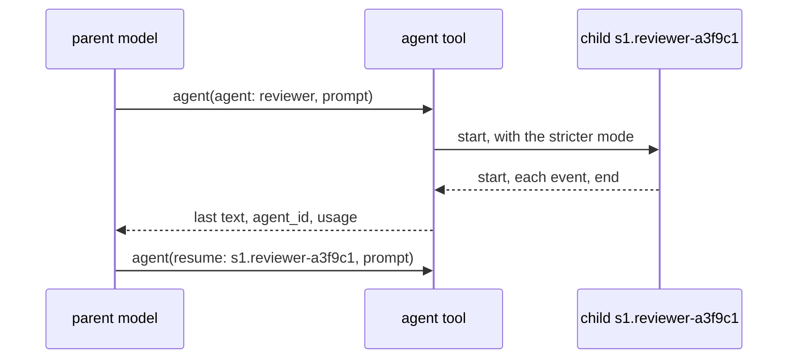

# Agent Tool

The agent tool gives a task to a named [subagent](../agent/subagent.md), which runs in a child session. The `agents` section of the system prompt lists the name and the description of each subagent.

## Design

- A child is an assembly of the same harness with the subagent on top, so it has the same readers, catalog, store, and seeders, and the harness has one path to build an agent.
- A child keeps its log in its own session of the store, so the history of the parent holds only the result, and a UI can open the child. The child log comes from [Codex](https://github.com/openai/codex/blob/8270a7c74d73ace00d93cdc5939a06c6cb811b1c/codex-rs/core/src/agent/control.rs) and [oh-my-pi](https://github.com/can1357/oh-my-pi/blob/06aecdd51f07e689e970ceaa180abe2be0c14bbb/packages/coding-agent/src/task/executor.ts).
- The ID of a child is the parent ID, ".", the name, "-", and random hex. A store that takes no "/" in an ID then keeps it, and the ID shows its parent. The "." after the parent ID comes from [oh-my-pi](https://github.com/can1357/oh-my-pi/blob/06aecdd51f07e689e970ceaa180abe2be0c14bbb/packages/coding-agent/src/task/output-manager.ts#L86).
- The result has the usage and the `agent_id`, so the model knows what the task cost and how to continue it. The `agent_id` comes from [Claude Code](https://web.archive.org/web/20261024135648/https://code.claude.com/docs/en/sub-agents).
- The `resume` input takes only a child of the current session, so the model cannot open another session of the store.
- A child gets no agent tool, so the depth is one, and a task tree cannot grow without a bound. The depth of one comes from the default of [Codex](https://github.com/openai/codex/blob/8270a7c74d73ace00d93cdc5939a06c6cb811b1c/codex-rs/core/src/config/mod.rs#L281).
- The tool runs the child to its end before it returns, so the end of the child always comes before the end of the call.
- A child runs in the stricter mode of the parent and its file, with the rules of the parent. A subagent file then cannot widen what a person approved.
- A model that the catalog does not know, such as the alias `opus`, gives the spec of the parent, so an agent file from Claude Code runs. A model that two providers serve fails the task, so the child does not run on a model that its file did not name.
- The `tools` key takes the tool names of Claude Code as aliases, so an agent file from Claude Code keeps its tools.

## Map

| Task                                                | File                       |
| --------------------------------------------------- | -------------------------- |
| Change what the agent tool takes or returns          | `pkg/harness/agent_tool.go` |
| Change the tools, the model, or the mode of a child | `pkg/harness/agent_tool.go` |
| Change what an agent file must hold                 | `pkg/store/fs/agents.go`   |
| Change the fields of a subagent                     | `pkg/def/agent.go`         |
| Change how the prompt lists the subagents           | `pkg/harness/prompt.go`    |

## Related Concepts

- [Subagent](../agent/subagent.md)
- [Harness](harness.md)
- [Definition](../def/definition.md)
- [Permission](permission.md)
- [Value](../session/value.md)
