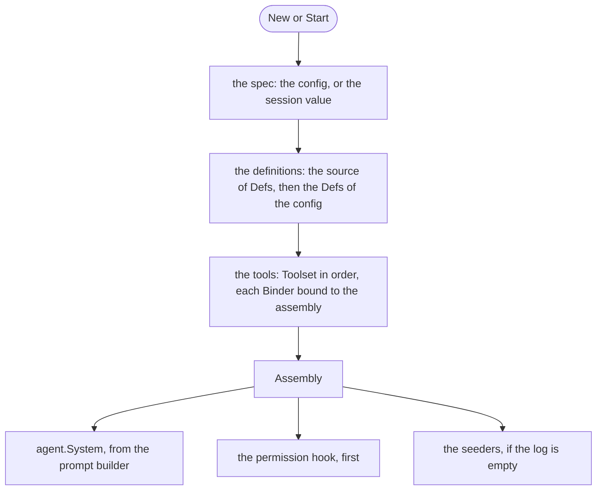

# Harness

A harness holds the builders of a coding agent: a catalog, a source of [definitions](../def/definition.md), the [tool list](../tool/tool-list.md), the Allow rules, a prompt builder, and the seeders. Each call of `New` or `Start` takes the config of one session, loads the definitions again, and resolves one assembly.

## Design

- The options of `New` set how the harness builds each agent. The config of a call holds the settings of one session, as for each [driver](../agent/driver.md), so the harness is a driver. A call works on a copy of the harness, so one harness serves many sessions at the same time. The cost: no single value holds the builders to print or to load from a file.
- The harness reads no file on its own. The caller gives the folders of definitions as one source, lowest first, so gopi has no opinion about folder layouts, and the caller picks what each session reads. The cost: a project set up for Claude Code loads only when the caller names its folders.
- The harness assembles on each call and caches nothing. An edit to an instruction file or a skill then reaches the next agent. A source that is slow caches on its own, because only it knows when its data changes.
- The agent calls the prompt builder before each model call, so a resumed session gets the definitions that the sources give now, as a section change after the history.
- The harness sets the permission hook first and `agent.System` and `agent.Store` after the agent options of the caller. A hook of the caller then sees only the calls that the rules let run, and the prompt of the harness and the store of the config win.
- The harness adds no tool of its own. Each tool comes from `Toolset`, and a `Binder` binds to each assembly, so one harness serves sessions with different folders, skills, and subagents.
- The default sandbox of a `Sandboxed` tool has no fence, so the harness runs on each OS. The [permission policy](../permission/permission.md) asks before a call outside `Dir` and `AddDirs`. `Fence` turns on the workspace fence, which runs only on macOS. On another OS, an assembly with `Fence` fails with a message that names `Sandbox`.

## Map

| Task                                              | File                         |
| ------------------------------------------------- | ---------------------------- |
| Change the steps of one call                      | `pkg/harness/harness.go`     |
| Change how an assembly loads definitions and tools | `pkg/harness/assembly.go`    |
| Change how a tool binds, or the default sandbox   | `pkg/harness/bind.go`        |
| Change the default prompt or the default seed     | `pkg/harness/prompt.go`      |
| Change how a SKILL.md or an agent file is parsed  | `pkg/store/fs/`              |
| Change the flags or the folders that `gopi` gives to the host and the harness | `cmd/gopi/main.go` |

## Related Concepts

- [Definition](../def/definition.md)
- [Skill](skill.md)
- [Agent Tool](agent-tool.md)
- [Permission](../permission/permission.md)
- [Catalog](../catalog/catalog.md)
- [Section](../agent/section.md)
- [Value](../session/value.md)
