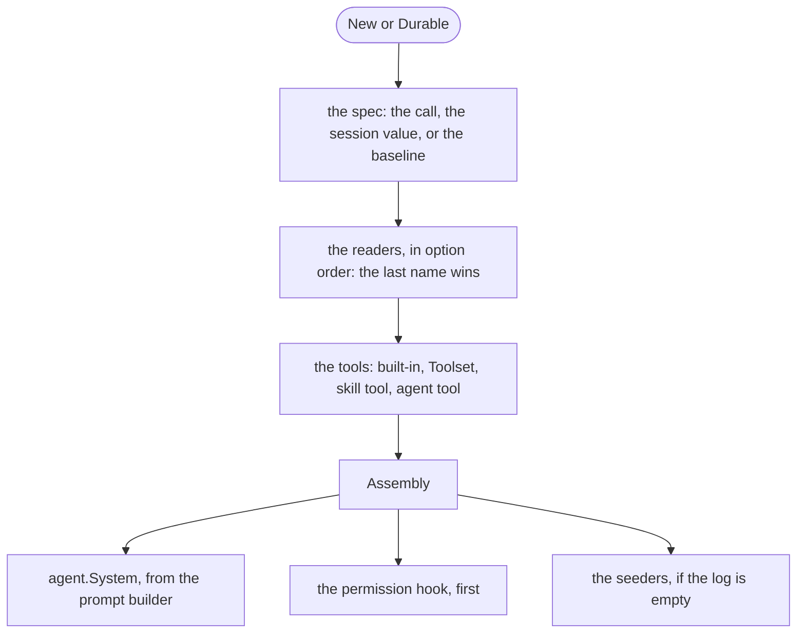

# Harness

A harness holds the builders of a coding agent: a catalog and a model spec, the readers of the definitions, the built-in tools, the permission rules, a prompt builder, and the seeders. Each call of `New` or `Durable` reads every reader again and resolves one assembly.

## Design

- The harness is one set of options, as `pkg/agent` is. A call applies the options of `New`, then its own, to a copy, so one harness serves many sessions at the same time. The cost: no single value holds the setup to print or to load from a file.
- The harness reads no file on its own. The caller gives each folder of definitions as a reader, lowest first, so gopi has no opinion about folder layouts, and the caller picks what each session reads. The cost: a project set up for Claude Code loads only when the caller names its folders.
- The harness assembles on each call and caches nothing. An edit to an instruction file or a skill then reaches the next agent. A reader that is slow caches on its own, because only it knows when its data changes.
- The agent calls the prompt builder before each model call, so a resumed session gets the definitions that the readers give now, as a section change after the history.
- The harness sets the permission hook first and `agent.System` and `agent.Store` after the agent options of the caller. A hook of the caller then sees only the calls that the rules let run, and the prompt and the store of the harness win.
- The default sandbox has the workspace fence. A coding agent then cannot write outside its folder by default. The fence runs only on macOS, so on another OS the assembly fails with a message that names `Sandbox`.

## Map

| Task                                              | File                         |
| ------------------------------------------------- | ---------------------------- |
| Change the steps of one call                      | `pkg/harness/harness.go`     |
| Change how skills and tools are merged            | `pkg/harness/assembly.go`    |
| Change the built-in tools or the default sandbox  | `pkg/harness/builtin.go`     |
| Change the default prompt or the default seed     | `pkg/harness/prompt.go`      |
| Change how a SKILL.md or an agent file is parsed  | `pkg/store/fs/`              |
| Change the flags or the folders that `gopi` gives to the harness | `cmd/gopi/main.go` |

## Related Concepts

- [Definition](../def/definition.md)
- [Skill](skill.md)
- [Agent Tool](agent-tool.md)
- [Permission](permission.md)
- [Catalog](../catalog/catalog.md)
- [Section](../agent/section.md)
- [Value](../session/value.md)
