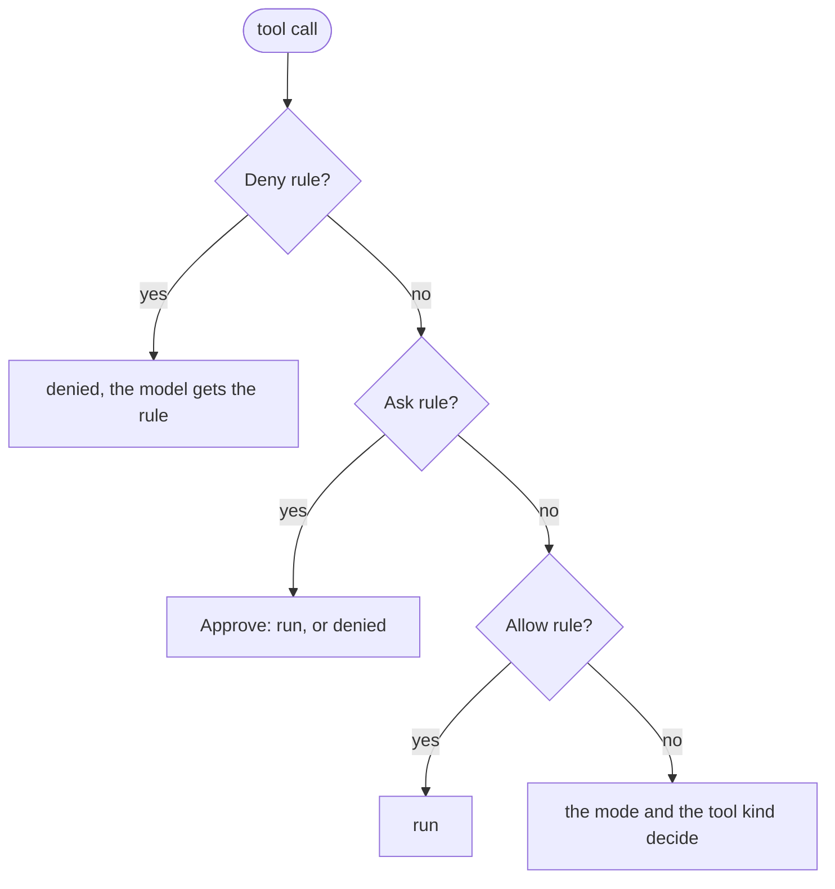

# Permission

A permission policy decides, for each tool call, if the call runs, asks a person, or is denied. It holds a permission mode and three lists of permission rules, such as `bash(git push *)` and `mcp__github__*`.

## Design

- The order of the checks, the rule format, the tool aliases, and the match rules for commands and paths come from [Claude Code](https://web.archive.org/web/20261028144314/https://code.claude.com/docs/en/permissions). A rule from a Claude Code settings file then works in gopi as it is.
- The permission policy is one `BeforeTool` hook over `agent.Deny`. The loop stays one model with tools, and the model gets the reason of each denial as a tool result, so it can try another way.
- A Deny rule and an Ask rule apply in every mode, also in `bypassPermissions`. A person can then let an agent run freely and still block one command.
- A tool that the permission policy does not know has the tool kind `Other`. A new tool then needs an approval or a rule before it runs.
- Without `Approve`, each call that needs an approval is denied, so an agent with no person present fails closed.
- An `Always` decision keeps an allow rule in the hook, and a new hook starts with no kept rules. An approval then lasts as long as one agent and does not reach the next session.
- If a decision edits the input, the edited input runs. The Deny rules check it, and an `Always` rule is for it, because the person approved the edited call and not the call of the model.
- The permission policy is a plain value, and the state of a run lives in its hook. The harness then copies the policy for each call and each child with no shared lock.
- A command rule matches the text of the command, not a parsed shell program. So a command rule is not a security boundary, and the [fence](../sandbox/fence.md) limits what a command can touch.
- An invalid rule fails the assembly, so a typo in a Deny rule cannot let every call through.

## Map

| Task                                         | File                                |
| -------------------------------------------- | ----------------------------------- |
| Change the order of the checks               | `pkg/harness/permission/policy.go`  |
| Change the kind of a built-in tool           | `pkg/harness/permission/kind.go`    |
| Change how a rule is parsed, or a tool alias | `pkg/harness/permission/rule.go`    |
| Change how a command rule matches            | `pkg/harness/permission/shell.go`   |
| Change how a path rule matches               | `pkg/harness/permission/path.go`    |
| Change how the CLI asks a person             | `cmd/gopi/ask.go`                   |

## Related Concepts

- [Harness](harness.md)
- [Loop](../agent/loop.md)
- [Fence](../sandbox/fence.md)
