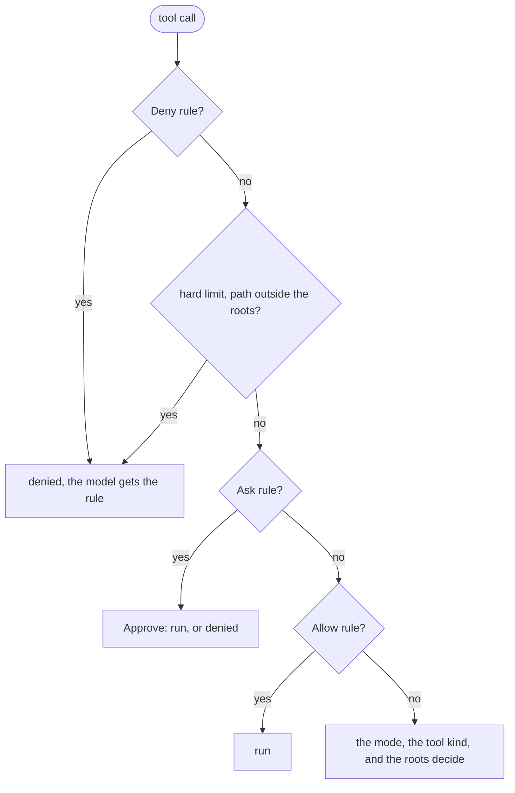

# Permission

A permission policy decides, for each tool call, if the call runs, asks a person, or is denied. It holds a permission mode and three lists of permission rules, such as `bash(git push *)` and `mcp__github__*`.

## Design

- The order of the checks, the rule format, and the match rules for commands and paths come from [Claude Code](https://web.archive.org/web/20261028144314/https://code.claude.com/docs/en/permissions). The parser reads a Claude Code name, such as `Read`, as the group of gopi tools that Claude Code applies it to, plus a tool with that literal name. A rule from a Claude Code settings file then works as written, as [Tool Name](../tool/name.md) describes.
- The content of an `apply_patch` rule matches each path that the patch changes. A Deny rule or an Ask rule matches if one path matches, and an Allow rule needs each path, so a patch cannot hide one file behind another.
- The permission policy is one `BeforeTool` hook over `agent.Deny`. The loop stays one model with tools, and the model gets the reason of each denial as a tool result, so it can try another way.
- A Deny rule and an Ask rule apply in every mode, also in `bypassPermissions`. A person can then let an agent run freely and still block one command.
- A tool that the permission policy does not know has the tool kind `tool.KindOther`. A new tool then needs an approval or a rule before it runs.
- The kind and the rule content of a well-known tool are in the registry of `pkg/tool`, with its names. One entry then gives a new well-known tool its names, its kind, and its rule content.
- Without `Approve`, each call that needs an approval is denied, so an agent with no person present fails closed.
- An `Always` decision keeps an allow rule in the hook, and a new hook starts with no kept rules. An approval then lasts as long as one agent and does not reach the next session.
- If a decision edits the input, the edited input runs. The Deny rules check it, and an `Always` rule is for it, because the person approved the edited call and not the call of the model.
- The permission policy is a plain value, and the state of a run lives in its hook. The harness then copies the policy for each call and each child with no shared lock.
- The mode step runs a read only in a root, and an edit in `acceptEdits` only in a root. The harness gives `Dir` and `AddDirs` as the roots. A call outside the roots asks, so an agent in `default` mode does not read the home folder of the user without a question.
- A path has one spelling for each symlink on the way, and one for its real path. A root check and an allow rule need each spelling, and a deny rule or an ask rule needs one, so a symlink in a root cannot take an allowed call out of it. A path whose symlinks do not resolve is denied in each mode.
- An edit of a protected path asks in `default` and `acceptEdits` mode. Git, a shell, or an editor runs these files outside the agent. The lists of protected paths come from Claude Code 2.1.316.
- A bash command whose parts are all read-only commands, such as `ls`, `cat`, `grep`, or `git status`, runs as a read: in a root with no question, and outside with a question. The parser asks when it cannot read a part, so an unknown flag or a `$` costs a question and not a wrong run. The list of commands comes from Claude Code 2.1.316.
- The hard limits deny a read or an edit outside the roots in each mode, also in `bypassPermissions`. They are off by default, so the caller picks between an agent that reaches each path and one that cannot leave its roots.
- A command rule matches the text of the command, not a parsed shell program. So a command rule is not a security boundary. Only the [fence](../sandbox/fence.md) of `harness.Fence` limits what a command can touch.
- An invalid rule fails the assembly, so a typo in a Deny rule cannot let every call through.

## Map

| Task                                         | File                                |
| -------------------------------------------- | ----------------------------------- |
| Change the order of the checks               | `pkg/harness/permission/policy.go`  |
| Change the kind of a built-in tool           | `pkg/tool/name.go`                  |
| Change how a rule is parsed                  | `pkg/harness/permission/rule.go`    |
| Change how a command rule matches            | `pkg/harness/permission/shell.go`   |
| Change how a path rule matches               | `pkg/harness/permission/path.go`    |
| Change the roots, the symlinks, or the protected paths | `pkg/harness/permission/roots.go` |
| Change the read-only commands or their flags | `pkg/harness/permission/readonly.go` |
| Change how a part of a command splits into words | `pkg/harness/permission/lex.go` |
| Change how the CLI asks a person             | `cmd/gopi/ask.go`                   |

## Related Concepts

- [Harness](harness.md)
- [Loop](../agent/loop.md)
- [Fence](../sandbox/fence.md)
