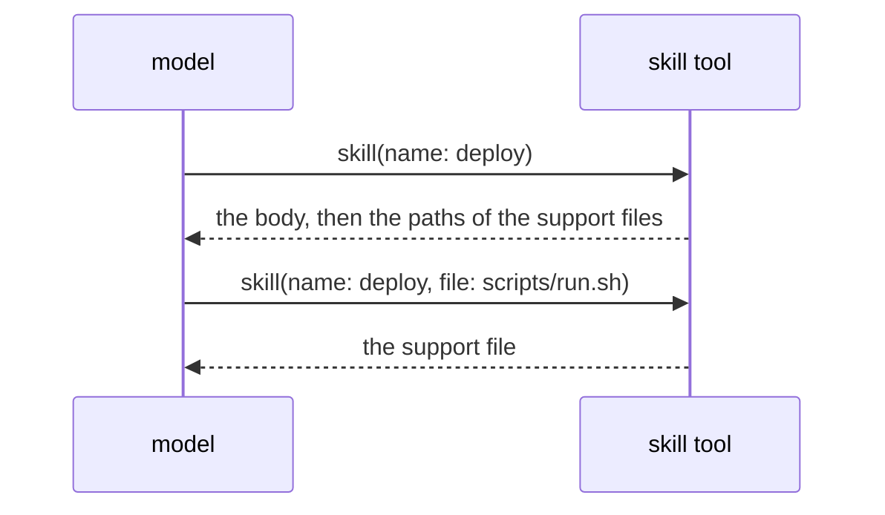

# Skill

A skill is a named body of instructions that the model loads on demand with the skill tool. The `skills` section of the system prompt lists the name and the description of each skill. A skill comes from a `SKILL.md` file or from code.

## Design

- The body reaches the model as a tool result, so a library of many skills costs one line for each skill until the model loads one.
- The list of skills is its own section, after the `system` and `instructions` sections. A change to a skill between two runs is then a section change after the history, so the start of the request stays cached.
- The name of a skill is the name of its folder, so the frontmatter cannot give two folders one name. The folder name and the qualified name come from [Claude Code](https://web.archive.org/web/20261028144715/https://code.claude.com/docs/en/skills).
- Skills merge by qualified name, so a skill of a later folder replaces a skill of an earlier folder with the same name. The caller sets the qualifier, and a reader of files leaves it empty.
- One skill gets the bare name: the last one in the order of the readers. The others keep their qualified names, so no skill is lost on a clash.
- The harness adds the skill tool only to an assembly with a skill that the model can call. A tool with nothing to load only makes the model call it for no result.
- A skill that the model cannot call stays in the assembly, so a caller such as a slash command can still run it.
- The support files of a skill are an `fs.FS`, and the skill tool reads them. A skill from an `embed.FS` then works as a skill on disk does, with no sandbox path.
- The reader keeps each frontmatter key that the harness does not use as an extra key. A file in the format of Claude Code or Codex then loads, and a caller reads the key with `Extra.Read`.
- If the YAML fails, the reader quotes each plain value and parses it again. A file that still fails, or that has no description and no body, is skipped, so one typo does not stop every session. The second parse comes from [Codex](https://github.com/openai/codex/blob/8270a7c74d73ace00d93cdc5939a06c6cb811b1c/codex-rs/skills/src/parser.rs#L50-L61).

## Map

| Task                                        | File                               |
| ------------------------------------------- | ---------------------------------- |
| Change what a SKILL.md file must hold       | `pkg/store/fs/frontmatter.go`      |
| Change how skills are read from a folder    | `pkg/store/fs/skills.go`           |
| Change how skills merge or get their names  | `pkg/harness/assembly.go`          |
| Change what the skill tool takes or returns | `pkg/harness/skill_tool.go`        |
| Change how the prompt lists the skills      | `pkg/harness/prompt.go`            |

## Related Concepts

- [Harness](harness.md)
- [Definition](../def/definition.md)
- [Tool](../tool/tool.md)
- [Section](../agent/section.md)
