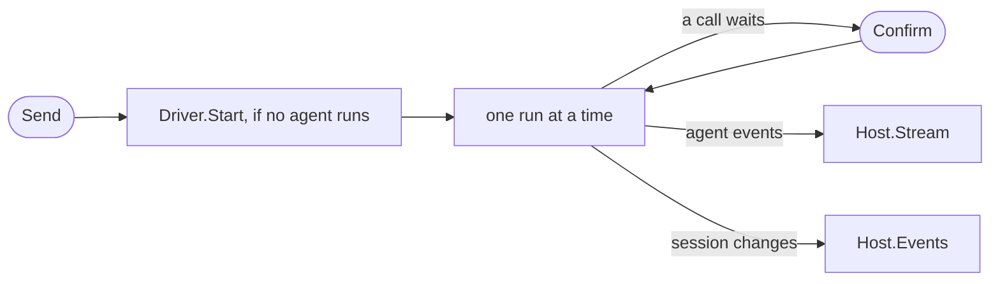

# Host

A host keeps the sessions of gopi agents for a Go program. The program creates it with a session config, and sends it user events by its ID: a message, an interrupt, or a confirmation. The [driver](../agent/driver.md) of its model spec starts the agent.

## Design

- The host gives its [tool list](../tool/tool-list.md) to each driver, and the config of a session picks a subset by name. The config keeps names and not tools, because a tool is code.
- A session is a resource with an ID, and a caller holds no handle. The host knows each session of the store, also one with no agent, so a read never asks if one runs.
- If a config has no ID, the host makes one with the function of `IDs`, or a UUIDv4 without it. A caller with its own form of ID gives its function, so its records and its sessions have one form.
- The user events and the names of the session status come from [Claude Managed Agents](https://web.archive.org/web/20261017131318/https://platform.claude.com/docs/en/managed-agents/events-and-streaming).
- `Create` keeps the session config, and each start of the agent reads it, so a session keeps its agent, its model, and its folder after a restart. The cost: an edit of an agent file, other than its prompt, reaches only a new session.
- The session config holds no prompt. Before each run, the host reads the prompt of the agent file, and the driver sends only the [sections](../agent/section.md) that changed. A prompt depends on a state that changes during a session, so a stored copy goes stale.
- `Open` makes each session that ran or waited idle, with the stop reason `restarted`, because no agent outlives a restart.
- `Release` stops the agent of an idle session, and `IdleTimeout` does it after an idle time. The agent of a CLI then frees its process, and the next message starts the agent again from the session config. An agent that ran to `Close` lost, because each idle session then kept a CLI process alive. A session that runs a child in the background keeps its agent.
- A message to a running session steers it, if the agent is a steerer. Otherwise the host holds the message for the end of the run, so a message is never lost.
- A call waits for its confirmation on a channel of its own, so calls wait at the same time and end in any order.
- The host checks the [permission rules](../harness/permission.md) of a session for each driver: the rules of the config, the rules of `Rules`, and the grants. One rule then matches the same calls on each driver. The driver gets only the Deny rules, to remove a tool.
- The host reads `Rules` at each checked call and keeps nothing, so an edit of a settings file reaches the next call. The cost: one read for each checked call. A read error blocks the call, so a broken settings file fails closed.
- A Deny rule or an Ask rule needs a `BeforeTool` hook, because a CLI runs a call that its mode allows with no approval request. The host adds the hook only to a session that can have such a rule, so Codex needs no hook command without one.
- The host keeps the exact rule of an `Always` decision as a grant in a session value, so the grant survives a restart and reaches each agent of the session. The agent gets the decision with no `Always`, so no CLI keeps a rule that the host cannot see.
- A safety check and a call that an Ask rule matches have no exact rule, so a person decides each one.
- The hook and the agent can ask about one call. The host remembers each call that a person allowed in the run, so the person answers once.
- Each event of `Events` has the whole session, so a reader needs no history.
- Each `Events` and `Stream` call gives a copy of the state and each event after it, under one lock, so a reader gets no gap and no repeat. A stalled reader loses its stream, so it cannot hold the events in memory.
- Two hosts on one store must not run the same session, because their entries interleave in one log.

## Map

| Task                                                | File                    |
| --------------------------------------------------- | ----------------------- |
| Create, read, or list a session                     | `pkg/host/host.go`      |
| Change the session status, or the recovery at Open  | `pkg/host/status.go`    |
| Change how an agent file fills a session config     | `pkg/host/agentfile.go` |
| Change how the agent of a session starts or stops   | `pkg/host/session.go`   |
| Change how a message steers, waits, or runs         | `pkg/host/run.go`       |
| Change how a call waits for Confirm                 | `pkg/host/approval.go`  |
| Change how the rules and the grants decide a call   | `pkg/host/rules.go`     |
| Change how a reader gets the state and the events   | `pkg/host/hub.go`       |

## Related Concepts

- [Driver](../agent/driver.md)
- [Child Session](child-session.md)
- [Section](../agent/section.md)
- [Definition](../def/definition.md)
- [Permission](../harness/permission.md)
