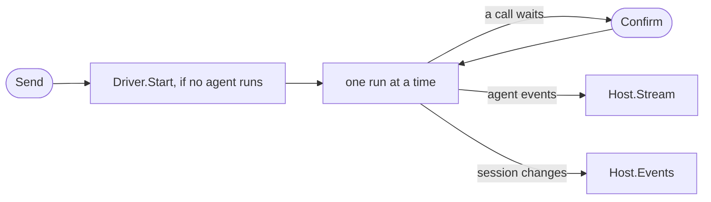

# Host

A host keeps the sessions of gopi agents for a Go program. The program creates it with a session config, and sends it user events by its ID: a message, an interrupt, or a confirmation. The [driver](../agent/driver.md) of its model spec starts the agent.

## Design

- A session is a resource with an ID, and a caller holds no handle. The host knows each session of the store, also one with no agent, so a read never asks if one runs.
- The user events and the names of the session status come from [Claude Managed Agents](https://web.archive.org/web/20261017131318/https://platform.claude.com/docs/en/managed-agents/events-and-streaming).
- `Create` keeps the session config, and each start of the agent reads it, so a session keeps its agent, its model, and its folder after a restart. The cost: an edit of an agent file, other than its prompt, reaches only a new session.
- The session config holds no prompt. Before each run, the host reads the prompt of the agent file, and the driver sends only the [sections](../agent/section.md) that changed. A prompt depends on a state that changes during a session, so a stored copy goes stale.
- `Open` makes each session that ran or waited idle, with the stop reason `restarted`, because no agent outlives a restart.
- A message to a running session steers it, if the agent is a steerer. Otherwise the host holds the message for the end of the run, so a message is never lost.
- A call waits for its confirmation on a channel of its own, so calls wait at the same time and end in any order.
- Each event of `Events` has the whole session, so a reader needs no history.
- Each `Events` and `Stream` call gives a copy of the state and each event after it, under one lock, so a reader gets no gap and no repeat. A stalled reader loses its stream, so it cannot hold the events in memory.
- Two hosts on one store must not run the same session, because their entries interleave in one log.

## Map

| Task                                                | File                    |
| --------------------------------------------------- | ----------------------- |
| Create, read, or list a session                     | `pkg/host/host.go`      |
| Change the session status, or the recovery at Open  | `pkg/host/status.go`    |
| Change how an agent file fills a session config     | `pkg/host/agentfile.go` |
| Change how the agent of a session starts or stops   | `pkg/host/session.go`   |
| Change how a message steers, waits, or runs         | `pkg/host/run.go`       |
| Change how a call waits for Confirm                 | `pkg/host/approval.go`  |
| Change how a reader gets the state and the events   | `pkg/host/hub.go`       |

## Related Concepts

- [Driver](../agent/driver.md)
- [Child Session](child-session.md)
- [Section](../agent/section.md)
- [Definition](../def/definition.md)
