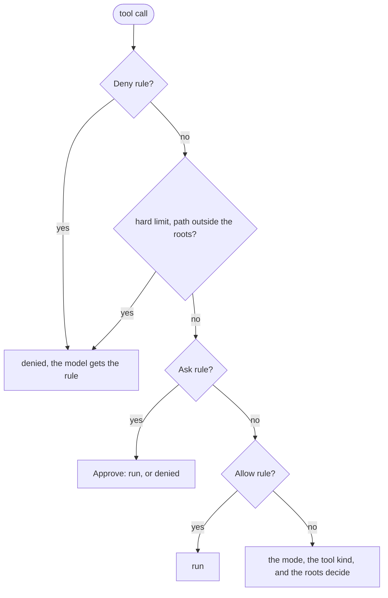

# Permission

A permission policy decides, for each tool call, if the call runs, asks a person, or is denied. It holds a permission mode and three lists of permission rules, such as `bash(git push *)` and `mcp__github__*`.

## Design

- The order of the checks, the rule format, and the match rules for commands and paths come from [Claude Code](https://web.archive.org/web/20261028144314/https://code.claude.com/docs/en/permissions). The parser reads a Claude Code name, such as `Read`, as the group of gopi tools that Claude Code applies it to, plus a tool with that literal name. A rule from a Claude Code settings file then works as written, as [Tool Name](../tool/name.md) describes.
- The content of an `apply_patch` rule matches each path that the patch changes. A Deny rule or an Ask rule matches if one path matches, and an Allow rule needs each path, so a patch cannot hide one file behind another.
- `pkg/permission` imports no agent. `Policy.Decide` returns a decision, and the harness turns it into one `BeforeTool` hook over `agent.Deny`. The package changes less often than `pkg/agent`, so `agent.Config`, each driver, and the host share its one `Mode` and its one `Limits`.
- The loop stays one model with tools, and the model gets the reason of each denial as a tool result, so it can try another way.
- A Deny rule and an Ask rule apply in every mode, also in `bypassPermissions`. A person can then let an agent run freely and still block one command.
- A tool that the permission policy does not know has the tool kind `tool.KindOther`. A new tool then needs an approval or a rule before it runs.
- The kind and the rule content of a well-known tool are in the registry of `pkg/tool`, with its names. One entry then gives a new well-known tool its names, its kind, and its rule content.
- Without `Approve`, each call that needs an approval is denied, so an agent with no person present fails closed.
- The hook of the harness keeps no rule for an `Always` decision. A [host](../host/host.md) keeps the exact rule as a grant, so one store of grants serves each driver.
- `permission.Exact` gives the exact rule of a call, and checks it with `Rules.Check`. A grant then allows the same command, path, host, or tool, and a `*` in a command is a literal.
- `Rules` holds one layer of rules with no mode, and `Merge` joins the layers. A Deny rule of any layer wins, then an Ask rule, then an Allow rule, so a lower layer cannot open what a higher layer closes. `Policy.Decide` uses the same function for this order, so a rule matches the same calls with a mode and without one.
- If a decision edits the input, the edited input runs, and the Deny rules check it. A person then cannot approve a call past a Deny rule.
- The permission policy is a plain value with no state. The harness then copies the policy for each call and each child with no shared lock.
- A host gives the harness only its Deny rules, and checks the other rules in its own hook after the hook of the policy. The policy still asks for each call that its mode asks for, and the host answers it with its rules first. If both hooks ask about one call, the person answers once.
- The mode step runs a read only in a root, and an edit in `acceptEdits` only in a root. The harness gives the folder of the sandbox and `AddDirs` as the roots, from the function that also builds the fence policy, so the policy and the fence agree on the folders of the agent. A call outside the roots asks, so an agent in `default` mode does not read the home folder of the user without a question.
- A path has one spelling for each symlink on the way, and one for its real path. A root check and an allow rule need each spelling, and a deny rule or an ask rule needs one, so a symlink in a root cannot take an allowed call out of it. A path whose symlinks do not resolve is denied in each mode.
- An edit of a protected path asks in `default` and `acceptEdits` mode, as a safety check. Git, a shell, or an editor runs these files outside the agent, so no rule and no grant allows the edit. The protected names are the list of the [fence](../sandbox/fence.md), and the policy also protects all of `.git` and `.claude`, because an edit tool has no reason to write there.
- A `WebFetch` rule takes `domain:` and a host, and matches the host exactly, as in Claude Code. A URL with no host matches each Deny rule and Ask rule, so it fails closed.
- A bash command whose parts are all read-only commands, such as `ls`, `cat`, `grep`, or `git status`, runs as a read: in a root with no question, and outside with a question. The parser asks when it cannot read a part, such as an unknown flag or a `$`, because a wrong guess runs a command with no question. The list of commands comes from Claude Code 2.1.316.
- The hard limits deny a read or an edit outside the roots in each mode, also in `bypassPermissions`. They are off by default, and a caller turns on each one by name.
- A command rule matches the text of the command, not a parsed shell program. So a command rule is not a security boundary. Only the [fence](../sandbox/fence.md) of `harness.Fence` limits what a command can touch.
- An invalid rule fails the assembly, so a typo in a Deny rule cannot let every call through.

## Map

| Task                                         | File                                |
| -------------------------------------------- | ----------------------------------- |
| Change the order of the checks               | `pkg/permission/policy.go`  |
| Change the kind of a built-in tool           | `pkg/tool/name.go`                  |
| Change how a rule is parsed                  | `pkg/permission/rule.go`    |
| Change how the rule layers merge or decide   | `pkg/permission/rules.go`   |
| Change the exact rule of a call              | `pkg/permission/exact.go`   |
| Change how a domain rule matches             | `pkg/permission/domain.go`  |
| Change how a command rule matches            | `pkg/permission/shell.go`   |
| Change how a path rule matches               | `pkg/permission/path.go`    |
| Change the roots or the symlinks             | `pkg/permission/roots.go` |
| Change the protected names                   | `pkg/sandbox/fence/fence.go` |
| Change the read-only commands or their flags | `pkg/permission/readonly.go` |
| Change how a part of a command splits into words | `pkg/permission/lex.go` |
| Change how the harness asks the approver     | `pkg/harness/permission.go`         |
| Change how the CLI asks a person             | `cmd/gopi/ask.go`                   |

## Related Concepts

- [Harness](../harness/harness.md)
- [Host](../host/host.md)
- [Loop](../agent/loop.md)
- [Fence](../sandbox/fence.md)
