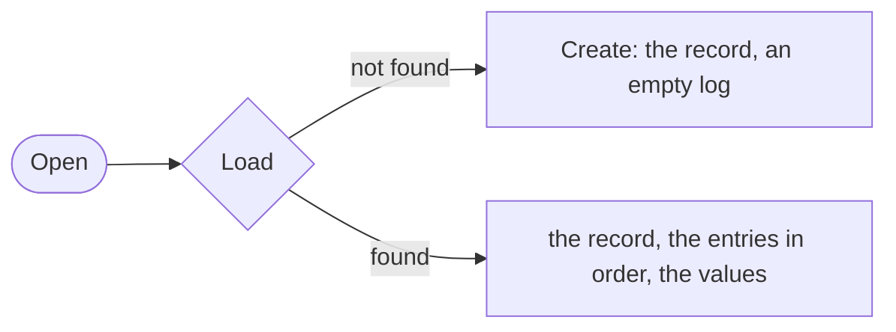

# Store

A store keeps three things for each session: the record, which says that the session exists, the entry log in append order, and the values. A log opens a session through a store and writes to it. The memory store is for tests and for an agent that ends with the process. The JSONL store is one append-only file per session.

## Design

- The interface of a store is the whole contract that a log needs, so a new database needs little code.
- The record holds an ID and a creation time, and nothing from the application. A title, a mode, or a model choice goes in a value, for the reasons in [Value](value.md).
- The caller fills every field of the record, the creation time included. A store has no clock of its own, so two stores write the same bytes for the same record.
- Load returns the record, the entries, and the values in one call. Open needs all of them, and one method is one round trip. Open creates or resumes, because both paths give the same ready log.
- The JSONL store keeps one file per session, and the first line is the record. A complete line that does not decode is an error, because a skipped line would lose history.
- A crash in the middle of a write leaves a torn last line with no newline, and Load cuts it from the file. A whole last line with no newline gets its newline, so the next append starts on a new line. No fsync runs, so a crash of the OS can lose the last lines.
- A failed append cuts the file back to its size before the write. A partial line would join the next line, and Load rejects a complete line that does not decode.
- A custom entry has the line type `message`, as a message entry does, so a reader of entries needs one line type.
- List reads each session file to its end and changes no file, so a second process can list the sessions while a writer runs. The cost is that a list reads every entry of every session.
- A value line is a write, not the state. Load replays the value lines in order, so the file never rewrites a line. The cost is that a value that changes often makes the file grow.

## Map

| Task                                         | File                         |
| -------------------------------------------- | ---------------------------- |
| Implement a store                            | `pkg/session/store.go`       |
| See a store in memory                        | `pkg/session/memstore.go`    |
| Change the file format                       | `pkg/store/fs/sessions.go`   |
| Change where the CLI keeps the session files | `cmd/gopi/main.go`           |

## Related Concepts

- [Log](log.md)
- [Value](value.md)
