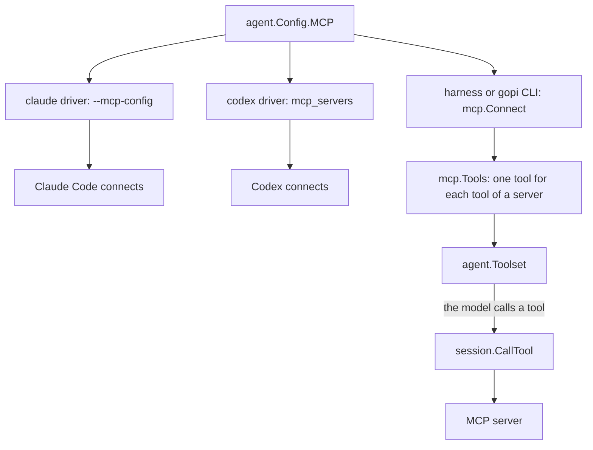

# MCP

An MCP server is a process or an HTTP endpoint that offers tools over the Model Context Protocol. A session names its servers in its config, and each driver gives them to its agent. The harness connects with `mcp.Connect`, and the agent runs an MCP tool as it runs any other tool.

## Design

- One type, `agent.MCPServer`, names a server for each driver. It has the fields of an entry of an mcp.json file, so the file of the CLI, the config of a session, and the arguments of Claude Code and Codex hold the same data.
- A CLI agent connects to its own servers, so gopi holds no MCP session for it. The servers of the settings of the CLI stay.
- `pkg/mcp` is in the root module, because the harness connects with it. The cost: each caller of gopi depends on the MCP SDK.
- `mcp.Tools` returns tools from `tool.Func`, so the agent and the providers need no MCP code. Its caller owns the session. `mcp.Connect` owns the sessions that it opens, and its close function closes them.
- The harness connects at `New` or `Durable`, and `agent.Agent.Close` closes the sessions. A subagent of the task tool shares the sessions of its parent, so a task call opens no connection.
- `mcp.Connect` returns the tools of each server that connected, also with an error. The harness then fails the start of the agent, because a config that names a server expects its tools. The CLI writes a warning and continues, so one server that is down does not stop the work.
- An MCP result with `isError` becomes an error result, and a failed call becomes a Go error. This obeys the two failure channels in [Tool](tool.md).
- `mcp.Tools` changes each character that a provider rejects in a tool name to `_`, and cuts the name to the length limit of the providers. If two tools then have the same name, it returns an error, because the model calls a tool by its name.
- The tools are fixed when `mcp.Tools` returns. `agent.Toolset` is fixed at `agent.New` or `agent.Durable`, so a change of the tool list that a server announces does not reach the model.
- `mcp.Connect` defers each tool, because one server can have many tools. The search tool loads them, as in [Tool Change](../agent/tool-change.md).
- `mcp.Connect` names each tool `mcp__<server>__<tool>`. If two server names, such as `a.b` and `a_b`, give one tool name, it keeps the first server and reports the other.
- The fence does not confine an MCP server. A stdio server is a normal process of the user, so it can write any file and use the network.

## Map

| Task                                       | File                         |
| ------------------------------------------ | ---------------------------- |
| Change how an MCP tool becomes a tool      | `pkg/mcp/mcp.go`             |
| Change how a result becomes content        | `pkg/mcp/mcp.go`             |
| Add a transport, or change the connect     | `pkg/mcp/connect.go`         |
| Change the fields of a server              | `pkg/agent/mcp.go`           |
| Change how Claude Code gets the servers    | `pkg/agent/claude/claude.go` |
| Change how Codex gets the servers          | `pkg/agent/codex/codex.go`   |
| Change when the harness connects           | `pkg/harness/harness.go`     |
| Change the format of the mcp.json file     | `cmd/gopi/mcp.go`            |

## Related Concepts

- [Tool](tool.md)
- [Tool Change](../agent/tool-change.md)
- [Fence](../sandbox/fence.md)
