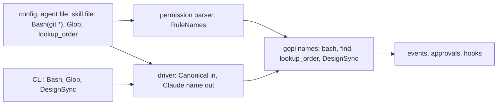

# Tool Name

A gopi name is the one name of a tool in gopi. A well-known tool has a snake case name, such as `bash` or `read_file`. Each other tool keeps its own name, such as `mcp__<server>__<tool>`, `lookup_order`, or `DesignSync`. The registry in `pkg/tool` holds the well-known tools. An entry holds the gopi name, the Claude Code names, the rule aliases, the kind, and the rule content of one tool.

## Design

- A name is mapped only where it is used: in the permission parser, in the tool filters, and at the edge of each driver. A config, an agent file, and a skill file keep their names as written, so the host and the file readers map nothing, and a saved session needs no migration.
- A call, an event, an approval, and a hook always carry the gopi name. One rule, hook, or approve function then works on each driver.
- The registry also holds each tool that only Claude Code has, such as `notebook_edit`, with its Claude Code name. An agent file that names one of them then reads the same on each driver, and passes the [tool list](tool-list.md) check.
- The registry maps only the names that it holds. Each other name passes through, so a tool of the caller, an MCP tool, and a tool of a CLI that the registry does not hold keep their names. The match is exact, so `BASH` is not `bash`.
- A tools list maps one name to one tool. A permission rule on a Claude Code name covers a group, as in Claude Code: `Read` also covers `grep` and `find`, and `Edit` also covers `write_file` and `apply_patch`.
- A rule and a tools list also keep the literal name. So a caller tool named `Read` matches a `Read` rule, and needs no exception.
- An entry holds each fact about a well-known tool that more than one package needs. The permission policy reads the kind and the rule content, and the Claude Code driver reads the Claude Code name. A new well-known tool then needs one entry.
- A driver changes the name of a call, not its input. A `read_file` call from Claude Code keeps `file_path`, so a reader of a call accepts the input of each driver.
- A host checks the rules with the permission parser for each driver, so a rule reads the gopi name on each driver. A driver of a CLI gives its CLI only the Deny rules that name a whole tool, with the name of the CLI.
- The event checks of the driver tests fail on a Claude Code name of a well-known tool. A recorded trace with a new name for such a tool then fails a test.

## Map

| Task                                          | File                                   |
| --------------------------------------------- | -------------------------------------- |
| Add a well-known tool, a name, or a fact      | `pkg/tool/name.go`                     |
| Change how a rule reads its tool names        | `pkg/permission/rule.go`       |
| Change how a tools list filters the tools     | `pkg/tool/select.go`, `pkg/harness/agent_tool.go`, `pkg/agent/only.go` |
| Change how the Claude Code driver writes names | `pkg/agent/claude/names.go`           |
| Change how a host checks the rules            | `pkg/host/rules.go`                    |
| Change the event checks of a driver test      | `pkg/agent/internal/emittest/check.go` |

## Related Concepts

- [Tool](tool.md)
- [Tool List](tool-list.md)
- [Permission](../permission/permission.md)
- [Driver](../agent/driver.md)
- [Definition](../def/definition.md)
