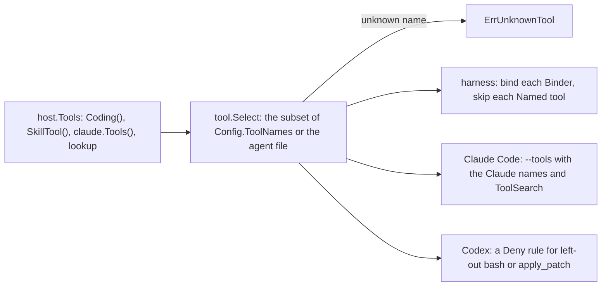

# Tool List

A tool list is the full set of tools of each session. The caller gives it with `host.Tools`, or with `harness.Toolset` on a harness. A config or an agent file picks a subset with its tool names and its Deny rules. Each driver gets the whole list and reads it in its own way.

## Design

- The list is the only source of tools. The harness adds no tool of its own, and `host.Open` fails without `host.Tools`, so a host never has no tool by mistake.
- A subset names tools of the list, and `tool.Select` fails on a name of no tool, because a typo must not remove a tool silently. The host checks the names at `Create` and `Update`, so a bad name makes no session. An MCP name passes, because the MCP servers of a config give their tools outside the list.
- A Deny rule with no content removes the tool, as in Claude Code. A rule with content keeps the tool and denies the calls that it matches. Codex cannot hide a tool, so its hook denies each call.
- A driver of a CLI reads only the names. It skips a well-known tool that its CLI does not have, and a tool of the caller, so one list serves each driver. A tool of the caller that the subset names fails, because the CLI cannot run its code.
- A tool that needs the session is a `harness.Binder`: the skill tool, the agent tool, and each tool of `Sandboxed`. One list then serves sessions with different folders, skills, and subagents.
- The harness picks the subset before it binds, so a name passes also when its tool binds to nothing, and a left-out tool makes no sandbox. A subagent narrows the subset of its parent with no check, because its file removes tools such as the agent tool.
- `tool.Named` stands for a tool that only a CLI runs, such as `apply_patch`. The presets `harness.Coding`, `claude.Tools`, and `codex.Tools` are lists that the caller spreads into `host.Tools`, so the list stays explicit.
- The hooks of Codex see only `bash` and `apply_patch`, so the Codex driver can remove only them, and a Codex agent always keeps `web_search` and `agent`.
- A default-driver harness takes no `Toolset`, because the host list comes on top of it. It takes `Sandbox`.
- The host keeps the names of a config, and not the list, because a tool is code. A session that names a tool of an earlier list fails at its next start.

## Map

| Task                                          | File                          |
| --------------------------------------------- | ----------------------------- |
| Change how a subset picks tools               | `pkg/tool/select.go`          |
| Add a Binder, or change how a tool binds      | `pkg/harness/bind.go`         |
| Change how Claude Code reads the list         | `pkg/agent/claude/names.go`   |
| Change how Codex reads the list               | `pkg/agent/codex/names.go`    |
| Change how the host gives the list            | `pkg/host/host.go`            |

## Related Concepts

- [Tool](tool.md)
- [Tool Name](name.md)
- [Harness](../harness/harness.md)
- [Host](../host/host.md)
- [Driver](../agent/driver.md)
